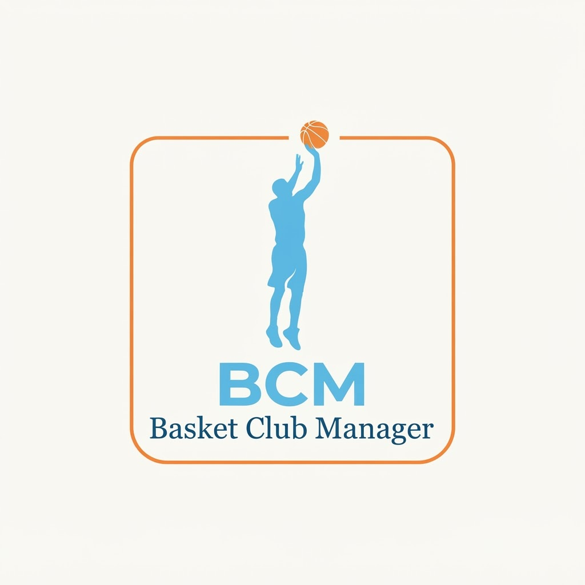

<div align="center">



# Basket Club Manager

**Courtside match scoring, roster management, and advanced basketball analytics.**

[](https://expo.dev)
[](https://reactnative.dev)
[](https://www.typescriptlang.org)
[](https://docs.expo.dev/versions/latest/sdk/sqlite/)
[](https://www.nativewind.dev)
[](https://jestjs.io)

[Features](#features) • [Tech Stack](#tech-stack) • [Getting Started](#getting-started) • [Project Structure](#project-structure) • [Testing](#testing)

</div>

---

**Basket Club Manager (BCM)** is an offline-first mobile application designed for basketball coaches, club managers, and scorers. Built with React Native and Expo, BCM enables live courtside game tracking, comprehensive roster administration, and instant box-score sharing without requiring an internet connection.

> [!NOTE]
> BCM is designed offline-first using local SQLite storage. All match events, player stints, and statistics are stored and computed directly on device, ensuring zero latency and zero data loss during live games in gyms with poor connectivity.

---

## Features

### Live Match Scoring & Courtside Control
- **Real-Time Scoreboard**: One-tap scoring for free throws (1PT), field goals (2PT), and three-pointers (3PT).
- **Match Clock & Quarters**: Game timer with period selection, customizable quarter lengths, and overtime support.
- **Fouls & Timeouts**: Track individual player fouls (with automatic foul trouble alerts), team fouls per quarter, and team timeouts.
- **Substitutions & Stints**: Live bench-to-court player rotations with accurate playing time tracking.
- **Play-by-Play & Undo**: Chronological event log with undo capability to correct accidental scoring or foul inputs.
- **Crash Recovery & Cache**: Continuous state persistence so matches can resume safely after unexpected app exits or battery loss.

### Roster & Squad Administration
- **Player Profiles**: Jersey numbers, primary positions (PG, SG, SF, PF, C), active status, and player details.
- **Match Roster Selection**: Enforce eligible active lineups before starting games.
- **Aggregated Performance**: Historical games played, total points, shooting splits, and foul distributions per player.

### Advanced Analytics & Match Sharing
- **Box Scores & Period Breakdowns**: Full FIBA-style box scores and quarter-by-quarter scoring tables.
- **Visual Analytics**: Polygon radar charts and team advanced metrics (effective field goal %, true shooting %, assist-to-turnover estimates).
- **Shareable Match Graphics**: Render and export high-resolution match summary cards to the device gallery or directly share via messaging platforms.

### In-App Notification Center
- **Context-Aware Alerts**: Non-intrusive notifications for bonus foul thresholds, individual foul-out warnings, and game milestones.
- **Configurable Sound & Vibration**: Haptic and audible feedback suited for bench environments.

---

## Tech Stack

| Layer | Technologies |
|---|---|
| **Core Framework** | [React Native](https://reactnative.dev) 0.86, [Expo](https://expo.dev) SDK 57 |
| **Language** | [TypeScript](https://www.typescriptlang.org) |
| **Database & Persistence** | [Expo SQLite](https://docs.expo.dev/versions/latest/sdk/sqlite/), [Drizzle ORM](https://orm.drizzle.team), TypeORM contracts |
| **State Management** | [Zustand](https://github.com/pmndrs/zustand) |
| **UI & Styling** | [NativeWind](https://www.nativewind.dev) (Tailwind CSS v3), Custom *CourtVision Kinetic* Design System |
| **Icons & Vectors** | `@expo/vector-icons`, `react-native-svg` |
| **Export & Sharing** | `react-native-view-shot`, `expo-sharing`, `expo-media-library` |
| **Testing** | [Jest](https://jestjs.io), `@testing-library/react-native` |

---

## Getting Started

### Prerequisites

- [Node.js](https://nodejs.org/) (version 20 or higher recommended)
- [npm](https://www.npmjs.com/) or [yarn](https://yarnpkg.com/)
- [Expo Go](https://expo.dev/go) app installed on your physical mobile device, or configured Android Studio / Xcode simulators.

### Installation

1. Clone the repository:
   ```bash
   git clone https://github.com/MrStegmann/bcmApp.git
   cd bcmApp
   ```

2. Install dependencies:
   ```bash
   npm install
   ```

3. Start the Expo development server:
   ```bash
   npm start
   ```

4. Run on your target platform:
   - **Expo Go (Physical Device)**: Scan the QR code displayed in your terminal using the Expo Go app (Android) or the Camera app (iOS).
   - **Android Simulator**: Press <kbd>a</kbd> in the terminal or run `npm run android`.
   - **iOS Simulator**: Press <kbd>i</kbd> in the terminal or run `npm run ios`.
   - **Web Preview**: Press <kbd>w</kbd> in the terminal or run `npm run web`.

> [!TIP]
> Use the `-c` flag (`npx expo start -c`) if you update Tailwind configurations or clear Metro cache.

---

## Project Structure

The project follows a feature-based architecture separating domain features, shared UI components, and the database layer:

```
bcmApp/
├── assets/                  # Logos, icons, and jersey graphic templates
├── specs/                   # Feature specifications and implementation plans
├── scripts/
│   └── seed-db.ts           # Development database seeder with mock match data
├── src/
│   ├── components/          # Reusable design system UI components & modals
│   ├── context/             # Global React contexts
│   ├── controllers/         # Business logic and domain controllers
│   ├── db/                  # SQLite schema definitions, migrations, and connection
│   ├── features/            # Feature-centric modules
│   │   ├── home-view/       # Dashboard overview, next match, and global stats
│   │   ├── match-detail/    # Box scores, quarter tables, radar charts, and sharing
│   │   ├── notifications/   # Notification lifecycle, rules evaluator, and toast UI
│   │   └── play-match/      # Live scoreboard, game clock, fouls, and substitutions
│   ├── models/              # Domain models and entities
│   ├── page/                # Top-level screen views (ClubManage, GameList, etc.)
│   ├── store/               # Zustand application stores
│   ├── types/               # TypeScript interfaces and type definitions
│   └── utils/               # Time formatters, input masks, and math utilities
├── App.tsx                  # App entry point, lifecycle, and DB bootstrap
├── app.json                 # Expo project configuration
└── tailwind.config.js       # CourtVision Kinetic color palette and tokens
```

---

## Testing

The project includes an extensive test suite covering feature components, math calculators, state machines, and cache services.

Run the full test suite with Jest:

```bash
npm test
```

Run tests in watch mode during feature development:

```bash
npm test -- --watch
```

Run tests for a specific feature:

```bash
npm test play-match
```
