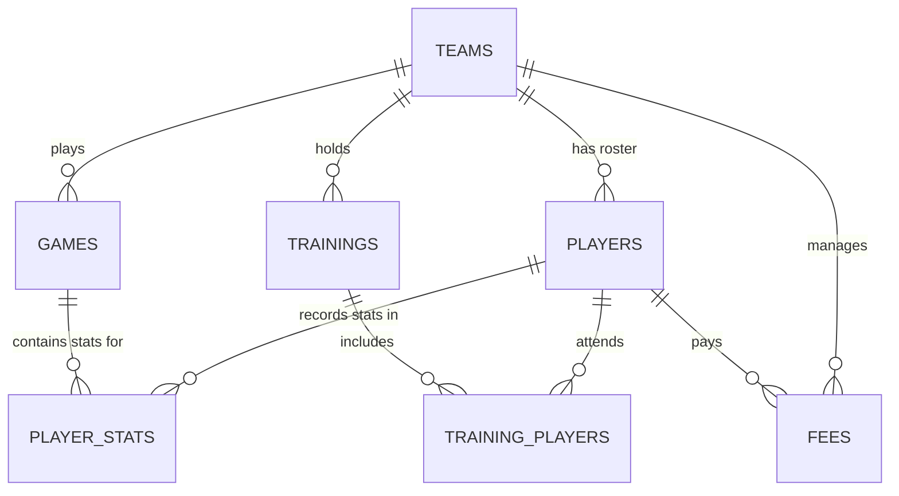

# Data Model & Relational Schema: Database & Contracts Refactor

## Entity Relationship Overview

## Relational Tables & Schema Definitions

### 1. `teams`
Represents a basketball club or team.

| Field | SQLite Type | Drizzle Type | Constraints | Description |
|---|---|---|---|---|
| `id` | INTEGER | `integer()` | PRIMARY KEY, AUTOINCREMENT | Unique team identifier |
| `name` | TEXT | `text()` | NOT NULL | Team name (e.g. "Furola CB 25/26") |
| `category` | TEXT | `text()` | NULLABLE | Category/Division |
| `created_at` | TEXT | `text()` | NOT NULL, DEFAULT ISO String | Creation timestamp |

---

### 2. `players`
Represents a team roster member.

| Field | SQLite Type | Drizzle Type | Constraints | Description |
|---|---|---|---|---|
| `id` | INTEGER | `integer()` | PRIMARY KEY, AUTOINCREMENT | Unique player identifier |
| `team_id` | INTEGER | `integer()` | NOT NULL, FOREIGN KEY -> `teams(id)` ON DELETE CASCADE | Parent team |
| `first_name` | TEXT | `text()` | NOT NULL | Player given name |
| `last_name` | TEXT | `text()` | NOT NULL | Player surname |
| `number` | TEXT | `text()` | NOT NULL | Jersey number (e.g. "10", "00") |
| `position` | TEXT | `text()` | NULLABLE | Playing position |
| `notes` | TEXT | `text()` | NULLABLE | Additional notes |
| `created_at` | TEXT | `text()` | NOT NULL, DEFAULT ISO String | Creation timestamp |

---

### 3. `games`
Represents a match played by a team.

| Field | SQLite Type | Drizzle Type | Constraints | Description |
|---|---|---|---|---|
| `id` | INTEGER | `integer()` | PRIMARY KEY, AUTOINCREMENT | Unique game identifier |
| `team_id` | INTEGER | `integer()` | NOT NULL, FOREIGN KEY -> `teams(id)` ON DELETE CASCADE | Parent team |
| `opponent` | TEXT | `text()` | NOT NULL | Opponent team name |
| `round` | INTEGER | `integer()` | NOT NULL, DEFAULT 1 | Match round / week |
| `date` | TEXT | `text()` | NOT NULL | Match date (DD/MM/YYYY) |
| `result_c1` | INTEGER | `integer()` | DEFAULT 0 | Team score in Q1 |
| `result_c2` | INTEGER | `integer()` | DEFAULT 0 | Team score in Q2 |
| `result_c3` | INTEGER | `integer()` | DEFAULT 0 | Team score in Q3 |
| `result_c4` | INTEGER | `integer()` | DEFAULT 0 | Team score in Q4 |
| `result_extra` | INTEGER | `integer()` | DEFAULT 0 | Team score in OT |
| `result_c1_opponent` | INTEGER | `integer()` | DEFAULT 0 | Opponent score in Q1 |
| `result_c2_opponent` | INTEGER | `integer()` | DEFAULT 0 | Opponent score in Q2 |
| `result_c3_opponent` | INTEGER | `integer()` | DEFAULT 0 | Opponent score in Q3 |
| `result_c4_opponent` | INTEGER | `integer()` | DEFAULT 0 | Opponent score in Q4 |
| `result_extra_opponent` | INTEGER | `integer()` | DEFAULT 0 | Opponent score in OT |

---

### 4. `player_stats`
Represents individual box score stats for a player in a game.

| Field | SQLite Type | Drizzle Type | Constraints | Description |
|---|---|---|---|---|
| `id` | INTEGER | `integer()` | PRIMARY KEY, AUTOINCREMENT | Unique box score row |
| `game_id` | INTEGER | `integer()` | NOT NULL, FOREIGN KEY -> `games(id)` ON DELETE CASCADE | Parent game |
| `player_id` | INTEGER | `integer()` | NOT NULL, FOREIGN KEY -> `players(id)` ON DELETE CASCADE | Parent player |
| `minutes` | INTEGER | `integer()` | DEFAULT 0 | Minutes played |
| `t1a` | INTEGER | `integer()` | DEFAULT 0 | 1pt Free throws made |
| `t1i` | INTEGER | `integer()` | DEFAULT 0 | 1pt Free throws attempted |
| `t2a` | INTEGER | `integer()` | DEFAULT 0 | 2pt Field goals made |
| `t2i` | INTEGER | `integer()` | DEFAULT 0 | 2pt Field goals attempted |
| `t3a` | INTEGER | `integer()` | DEFAULT 0 | 3pt Field goals made |
| `t3i` | INTEGER | `integer()` | DEFAULT 0 | 3pt Field goals attempted |
| `oreb` | INTEGER | `integer()` | DEFAULT 0 | Offensive rebounds |
| `dreb` | INTEGER | `integer()` | DEFAULT 0 | Defensive rebounds |
| `asis` | INTEGER | `integer()` | DEFAULT 0 | Assists |
| `rec` | INTEGER | `integer()` | DEFAULT 0 | Steals / recoveries |
| `per` | INTEGER | `integer()` | DEFAULT 0 | Turnovers / lost balls |
| `falt` | INTEGER | `integer()` | DEFAULT 0 | Personal fouls |
| `valuation` | INTEGER | `integer()` | DEFAULT 0 | Efficiency valuation |

---

### 5. `trainings`
Represents a practice / training session.

| Field | SQLite Type | Drizzle Type | Constraints | Description |
|---|---|---|---|---|
| `id` | INTEGER | `integer()` | PRIMARY KEY, AUTOINCREMENT | Unique training identifier |
| `team_id` | INTEGER | `integer()` | NOT NULL, FOREIGN KEY -> `teams(id)` ON DELETE CASCADE | Parent team |
| `training_number` | INTEGER | `integer()` | NOT NULL | Training session number |
| `date` | TEXT | `text()` | NOT NULL | Session date (DD/MM/YYYY) |
| `warmup1` | TEXT | `text()` | NULLABLE | Warmup exercise 1 title |
| `warmup1_explanation` | TEXT | `text()` | NULLABLE | Warmup 1 notes |
| `warmup2` | TEXT | `text()` | NULLABLE | Warmup exercise 2 title |
| `warmup2_explanation` | TEXT | `text()` | NULLABLE | Warmup 2 notes |
| `warmup3` | TEXT | `text()` | NULLABLE | Warmup exercise 3 title |
| `warmup3_explanation` | TEXT | `text()` | NULLABLE | Warmup 3 notes |
| `exercise1` | TEXT | `text()` | NULLABLE | Exercise 1 title |
| `exercise1_explanation` | TEXT | `text()` | NULLABLE | Exercise 1 notes |
| `exercise2` | TEXT | `text()` | NULLABLE | Exercise 2 title |
| `exercise2_explanation` | TEXT | `text()` | NULLABLE | Exercise 2 notes |
| `exercise3` | TEXT | `text()` | NULLABLE | Exercise 3 title |
| `exercise3_explanation` | TEXT | `text()` | NULLABLE | Exercise 3 notes |
| `exercise4` | TEXT | `text()` | NULLABLE | Exercise 4 title |
| `exercise4_explanation` | TEXT | `text()` | NULLABLE | Exercise 4 notes |
| `exercise5` | TEXT | `text()` | NULLABLE | Exercise 5 title |
| `exercise5_explanation` | TEXT | `text()` | NULLABLE | Exercise 5 notes |
| `exercise6` | TEXT | `text()` | NULLABLE | Exercise 6 title |
| `exercise6_explanation` | TEXT | `text()` | NULLABLE | Exercise 6 notes |
| `cooldown1` | TEXT | `text()` | NULLABLE | Cooldown 1 title |
| `cooldown1_explanation` | TEXT | `text()` | NULLABLE | Cooldown 1 notes |
| `cooldown2` | TEXT | `text()` | NULLABLE | Cooldown 2 title |
| `cooldown2_explanation` | TEXT | `text()` | NULLABLE | Cooldown 2 notes |

---

### 6. `training_players`
Represents player attendance in a training session.

| Field | SQLite Type | Drizzle Type | Constraints | Description |
|---|---|---|---|---|
| `id` | INTEGER | `integer()` | PRIMARY KEY, AUTOINCREMENT | Unique attendance row |
| `training_id` | INTEGER | `integer()` | NOT NULL, FOREIGN KEY -> `trainings(id)` ON DELETE CASCADE | Parent training |
| `player_id` | INTEGER | `integer()` | NOT NULL, FOREIGN KEY -> `players(id)` ON DELETE CASCADE | Parent player |
| `attended` | INTEGER | `integer()` | NOT NULL, DEFAULT 1 | Attendance flag (1=yes, 0=no) |
| `notes` | TEXT | `text()` | NULLABLE | Attendance notes |

---

### 7. `fees`
Represents team fee entries for calendar tracking.

| Field | SQLite Type | Drizzle Type | Constraints | Description |
|---|---|---|---|---|
| `id` | INTEGER | `integer()` | PRIMARY KEY, AUTOINCREMENT | Unique fee entry |
| `team_id` | INTEGER | `integer()` | NOT NULL, FOREIGN KEY -> `teams(id)` ON DELETE CASCADE | Parent team |
| `player_id` | INTEGER | `integer()` | NULLABLE, FOREIGN KEY -> `players(id)` ON DELETE CASCADE | Optional player reference |
| `month` | TEXT | `text()` | NOT NULL | Fee month name or number |
| `year` | INTEGER | `integer()` | NOT NULL | Fee year |
| `amount` | REAL | `real()` | NOT NULL, DEFAULT 0.0 | Fee amount |
| `paid` | INTEGER | `integer()` | NOT NULL, DEFAULT 0 | Payment status (1=paid, 0=pending) |
| `due_date` | TEXT | `text()` | NULLABLE | Due date |
