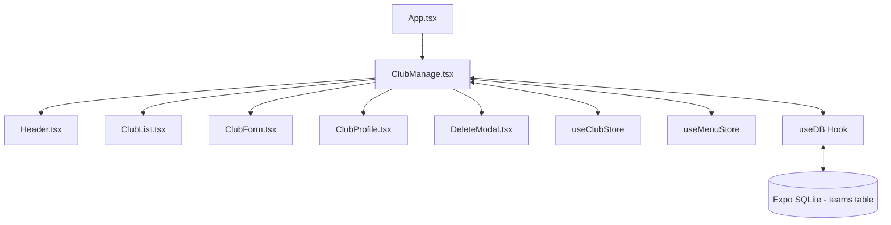

# Data Model: Refactor Club Manager View Page

**Feature**: Refactor Club Manager View Page (`specs/002-club-manager-view`)
**Date**: 2026-09-27

## Entities & Contracts

### 1. Team Entity Model (Drizzle Schema: `teams`)

```ts
export interface Team {
  id: number;          // Primary Key (Auto-increment)
  name: string;        // Team / Club Name (Required)
  category?: string | null;  // E.g., "Senior Masculino", "Junior Femenino"
  createdAt: string;   // ISO Timestamp or SQLite datetime('now')
}

export interface NewTeam {
  name: string;
  category?: string | null;
}
```

### 2. Club Store Interface (`ClubState`)

```ts
export interface ClubState {
  currentTeam: Team | null;
  club: Team | null; // Alias for currentTeam compatibility
  teamsList: Team[];
  isLoading: boolean;
  error: string | null;

  // Actions
  fetchTeams: () => Promise<Team[]>;
  selectTeam: (teamId: number) => void;
  setClub: (team: Team | null) => void;
  createTeam: (team: NewTeam) => Promise<Team | null>;
  updateTeam: (teamId: number, data: Partial<NewTeam>) => Promise<boolean>;
  deleteTeam: (teamId: number) => Promise<boolean>;
  setCurrentTeam: (team: Team | null) => void;
}
```

### 3. Component Data Flow Diagram



## Validation & State Rules

1. **Team Name Validation**: `name.trim().length > 0`. If empty, insertion/update is blocked and inline error displayed.
2. **Cascading Delete**: Deleting a team cascades SQLite foreign key removal to `players`, `games`, `trainings`, and `fees`.
3. **Active Selection**: Setting `currentTeam` updates `ClubStore` state synchronously, notifying sub-views.
