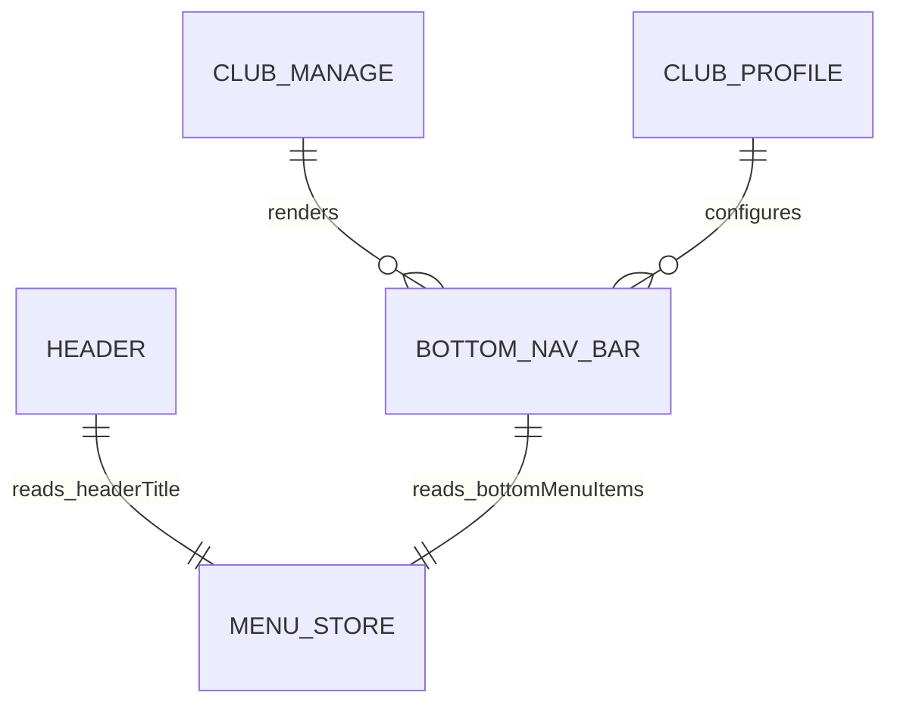

# Data Model & State Schema: Bottom Navigation & Routing

**Feature**: Bottom Menu Navigation & Routing Performance Improvement (`specs/003-bottom-navigation-routes`)
**Date**: 2026-09-28

## State Schemas

### 1. `MenuStoreState` (Zustand)

Manages active navigation tab, header view title, and bottom navigation bar menu item items.

```typescript
export interface BottomMenuItem {
  id: TopMenuEnums;
  label: string;
  iconName: string; // Vector icon name (Feather, Entypo, MaterialIcons, etc.)
  iconFamily?: "Entypo" | "Feather" | "MaterialIcons" | "Foundation" | "MaterialCommunityIcons" | "FontAwesome5";
  onPress: () => void;
}

export interface MenuStoreState {
  activeTab: TopMenuEnums;
  headerTitle: string;
  bottomMenuItems: BottomMenuItem[];
  setActiveTab: (tab: TopMenuEnums) => void;
  setHeaderTitle: (title: string) => void;
  setBottomMenu: (items: BottomMenuItem[]) => void;
}
```

## Entity Relationships



## State Transitions

### Main View (Team List)
- **Header Title**: `"Gestión de Equipos"`
- **Bottom Menu**: Single action `[ "Añadir Equipo" ]` or empty bar when list is scrollable.

### Team Profile View (Active Team Selected)
- **Header Title**: Matches active tab title (`"Plantilla de Jugadores"`, `"Partidos"`, `"Entrenamientos"`, `"Calendario de Cuotas"`).
- **Bottom Menu Items**:
  1. `PLAYERS` -> Label: `"Plantilla"`, Icon: `users`
  2. `GAMES` -> Label: `"Partidos"`, Icon: `basketball-hoop-outline`
  3. `TRAININGS` -> Label: `"Entrenamientos"`, Icon: `clipboard-notes`
  4. `CALENDAR` -> Label: `"Cuotas"`, Icon: `calendar`
  5. `GO_BACK` -> Label: `"Volver"`, Icon: `door-open`
