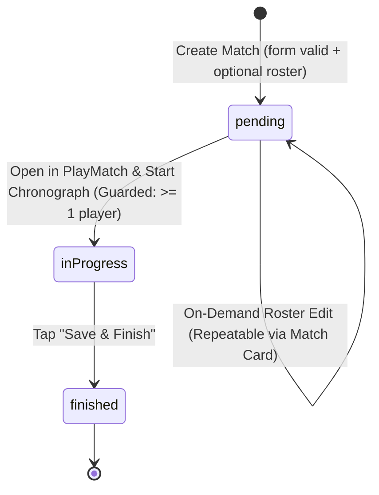

# Data Model & State Machine: Matches & New Match Workflow (Date-Only Mask & Roster Management)

## 1. Entities

### Match / Game (`games` table)

| Field | Type | Constraints | Description |
|---|---|---|---|
| `id` | `INTEGER` | PRIMARY KEY, AUTOINCREMENT | Unique match ID |
| `teamId` | `INTEGER` | NOT NULL, FK -> `teams.id` (CASCADE) | Associated club/team |
| `rivalTeamName` / `opponent` | `TEXT` | NOT NULL | Name of the opposing team |
| `round` | `TEXT` | NOT NULL, DEFAULT '1' | Fixture round (e.g. "Jornada 1", "Cuartos", "Round 5") |
| `date` / `timeStamp` | `TEXT` | NOT NULL | Scheduled match date formatted strictly as `dd/mm/aaaa` (e.g. `23/10/2026`) |
| `status` | `TEXT` | NOT NULL, DEFAULT 'pending' | Current match lifecycle state: `'pending' \| 'inProgress' \| 'finished'` |
| `createdAt` | `TEXT` | NOT NULL, DEFAULT `(datetime('now'))` | ISO creation timestamp for recency sorting |
| `resultC1` | `INTEGER` | DEFAULT 0 | Q1 team points |
| `resultC2` | `INTEGER` | DEFAULT 0 | Q2 team points |
| `resultC3` | `INTEGER` | DEFAULT 0 | Q3 team points |
| `resultC4` | `INTEGER` | DEFAULT 0 | Q4 team points |
| `resultExtra` | `INTEGER` | DEFAULT 0 | Overtime team points |
| `resultC1Opponent` | `INTEGER` | DEFAULT 0 | Q1 rival points |
| `resultC2Opponent` | `INTEGER` | DEFAULT 0 | Q2 rival points |
| `resultC3Opponent` | `INTEGER` | DEFAULT 0 | Q3 rival points |
| `resultC4Opponent` | `INTEGER` | DEFAULT 0 | Q4 rival points |
| `resultExtraOpponent` | `INTEGER` | DEFAULT 0 | Overtime rival points |

---

### Match Roster / Player Box Score (`player_stats` table)

| Field | Type | Constraints | Description |
|---|---|---|---|
| `id` | `INTEGER` | PRIMARY KEY, AUTOINCREMENT | Unique stat/roster record ID |
| `gameId` | `INTEGER` | NOT NULL, FK -> `games.id` (CASCADE) | Associated match ID |
| `playerId` | `INTEGER` | NOT NULL, FK -> `players.id` (CASCADE) | Associated player ID |
| `minutes` | `INTEGER` | DEFAULT 0 | Minutes played |
| `t1a` / `t1i` | `INTEGER` | DEFAULT 0 | Free throws made / attempted |
| `t2a` / `t2i` | `INTEGER` | DEFAULT 0 | 2-pointers made / attempted |
| `t3a` / `t3i` | `INTEGER` | DEFAULT 0 | 3-pointers made / attempted |
| `oreb` / `dreb` | `INTEGER` | DEFAULT 0 | Offensive / defensive rebounds |
| `asis` | `INTEGER` | DEFAULT 0 | Assists |
| `rec` | `INTEGER` | DEFAULT 0 | Steals |
| `per` | `INTEGER` | DEFAULT 0 | Turnovers |
| `falt` | `INTEGER` | DEFAULT 0 | Fouls |
| `valuation` | `INTEGER` | DEFAULT 0 | Calculated player efficiency |

---

## 2. Match Lifecycle State Machine & Roster Permissions Matrix

### State Definitions & Permissions Matrix

| Match Status | Roster Button Visible | Roster Button Enabled | Allowed Roster Operations | Navigation on Match Tap |
|---|---|---|---|---|
| **`pending`** (Upcoming) | **YES** | **YES** | **Full Read / Write** (Select, deselect, save, repeatedly tweak line-up) | Direct to `PlayMatch` if roster defined; Mandatory Roster Modal if roster empty |
| **`inProgress`** (Live Game) | **YES** | **NO** (Disabled, dimmed opacity) | **Locked** (In-game substitutions handled inside `PlayMatch` only) | Direct to `PlayMatch` live tracker |
| **`finished`** (Archived) | **YES** | **NO** (Disabled, dimmed opacity) | **Locked** (Read-only historical statistics) | Direct to `MatchDetailView` summary |

### State Guards

1. **`pending` -> `inProgress` Transition Guard**:
   - Match must have at least 1 declared roster player before transition into active game tracking is permitted.
   - If a match in `pending` state has 0 roster players (either skipped at creation or all players subsequently deselected in on-demand editing), tapping the match card displays the blocking **Mandatory Roster Modal**.
2. **Roster Edit Guard**:
   - Only matches with status `pending` (or undefined status falling back to pending) can trigger the roster selection modal from the match card.
   - Matches with status `inProgress` or `finished` reject roster modification attempts from the match card and present a disabled button.

---

## 3. Validation Rules & Invariants

- **`round`**: Non-empty string.
- **`rivalTeamName`**: Non-empty string.
- **`date`**:
  - Strictly `dd/mm/aaaa` format (e.g. `23/10/2026`).
  - Digits only: User inputs digits `0-9`; non-numeric characters are blocked/stripped.
  - Slashes auto-inserted: Automatically masked as `/` between day, month, and year.
  - Gregorian Calendar:
    - Day: `01` to `31` (dependent on month length).
    - Month: `01` to `12`.
    - Year: 4 digits (e.g. `2024`, `2026`).
    - Leap Year: `29/02` allowed only in leap years (e.g. `2024`, `2028`); rejected in common years (`2025`, `2026`).
    - 30-Day Months: April, June, September, November reject day 31.
- **Roster Management Invariants**:
  - Maximum 12 players per match roster.
  - On-demand editing on upcoming matches permits saving between 0 and 12 players.
  - Deselecting all players safely removes all player roster associations for that game from `player_stats`.
  - Re-opening an upcoming match's roster pre-populates all currently selected players.
