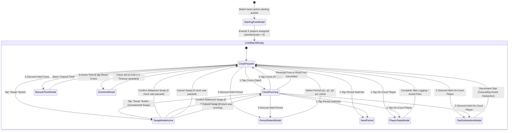

# Data Model: Play Match View

**Feature**: `007-play-match-view` | **Date**: 2026-10-24 (Updated with Stint Tracking, Rival Layout, Long-Press Stat Subtraction & Unrestricted Substitutions)

## 1. Domain Entities & Database Schema Mapping

### Database Persistence (`games` & `player_stats`)

Managed by Drizzle ORM in `src/db/schema.ts`:

```typescript
// Games Table
export const games = sqliteTable("games", {
  id: integer("id").primaryKey({ autoIncrement: true }),
  teamId: integer("team_id").notNull().references(() => teams.id, { onDelete: "cascade" }),
  opponent: text("opponent").notNull(),
  round: text("round").notNull().default("1"),
  date: text("date").notNull(),
  status: text("status").notNull().default("pending"), // "pending" | "inProgress" | "finished"
  createdAt: text("created_at").notNull().$defaultFn(() => new Date().toISOString()),
  resultC1: integer("result_c1").default(0),            // Maps to q1 home score
  resultC2: integer("result_c2").default(0),            // Maps to q2 home score
  resultC3: integer("result_c3").default(0),            // Maps to q3 home score
  resultC4: integer("result_c4").default(0),            // Maps to q4 home score
  resultExtra: integer("result_extra").default(0),      // Maps to extra home score
  resultC1Opponent: integer("result_c1_opponent").default(0), // Maps to q1 rival score
  resultC2Opponent: integer("result_c2_opponent").default(0), // Maps to q2 rival score
  resultC3Opponent: integer("result_c3_opponent").default(0), // Maps to q3 rival score
  resultC4Opponent: integer("result_c4_opponent").default(0), // Maps to q4 rival score
  resultExtraOpponent: integer("result_extra_opponent").default(0), // Maps to extra rival score
});

// Player Stats Table
export const playerStats = sqliteTable("player_stats", {
  id: integer("id").primaryKey({ autoIncrement: true }),
  gameId: integer("game_id").notNull().references(() => games.id, { onDelete: "cascade" }),
  playerId: integer("player_id").notNull().references(() => players.id, { onDelete: "cascade" }),
  minutes: integer("minutes").default(0), // Cumulative match minutes
  t1a: integer("t1a").default(0),
  t1i: integer("t1i").default(0),
  t2a: integer("t2a").default(0),
  t2i: integer("t2i").default(0),
  t3a: integer("t3a").default(0),
  t3i: integer("t3i").default(0),
  oreb: integer("oreb").default(0),
  dreb: integer("dreb").default(0),
  asis: integer("asis").default(0),
  rec: integer("rec").default(0),   // Steals / Ball recuperation
  per: integer("per").default(0),   // Turnovers / Ball lost
  falt: integer("falt").default(0), // Personal fouls
  valuation: integer("valuation").default(0),
});
```

---

## 2. In-Memory Live Match State (`usePlayMatchStore`)

Managed in the centralized Zustand global state store:

```typescript
export type PeriodKey = "q1" | "q2" | "q3" | "q4" | "extra";

export interface PeriodData {
  key: PeriodKey;
  label: string;             // "Q1", "Q2", "Q3", "Q4", "EXTRA"
  remainingSeconds: number;  // 600 default for Q1-Q4 (10min), 300 for EXTRA (5min)
  teamScore: number;
  rivalScore: number;
  teamFouls: number;
  rivalFouls: number;
  isCompleted: boolean;
}

export interface InGamePlayer {
  id: number;
  firstName: string;
  lastName: string;
  number?: string | null; // Optional or nullable jersey number
  position?: string | null;
  isOnCourt: boolean;
  courtPositionIndex?: number | null; // 0, 1, 2, 3, 4 for the 5 half-court positions
  secondsPlayed: number; // Cumulative total seconds played across all stints (persisted to DB)
  stintSeconds: number;  // Continuous seconds played in current on-court stint (displayed on court circles)
  t1a: number; // 1pt made
  t1i: number; // 1pt missed
  t2a: number; // 2pt made
  t2i: number; // 2pt missed
  t3a: number; // 3pt made
  t3i: number; // 3pt missed
  oreb: number; // Offensive rebound
  dreb: number; // Defensive rebound
  asis: number; // Assists
  rec: number;  // Ball recuperation (steals)
  per: number;  // Ball lost (turnovers)
  falt: number; // Personal fouls
  valuation: number;
}

/**
 * Score Event Record with Assist Linkage
 * Enables cascading assist reversal when made baskets are decremented.
 */
export interface ScoreEventLink {
  id: string;
  scoringPlayerId: number;
  period: PeriodKey;
  shotType: "t2a" | "t3a";
  points: 2 | 3;
  assistingPlayerId?: number | null; // null if recorded as "non assistant"
  timestamp: number;
}

export type PlayerIdentifierInput = {
  number?: string | null;
  firstName?: string | null;
  lastName?: string | null;
};

export interface TimeoutBudget {
  firstHalfRemaining: number;  // Initialized to 2 (shared for q1 & q2)
  secondHalfRemaining: number; // Initialized to 3 (shared for q3 & q4)
  extraTimeRemaining: number;  // Initialized to 1, +1 added per crono reset
}

export interface SwapState {
  isSwapMode: boolean;
  selectedCourtPlayerIds: number[];
  selectedBenchPlayerIds: number[];
}

export interface PlayMatchState {
  matchId: number;
  activePeriod: PeriodKey;
  periods: Record<PeriodKey, PeriodData>;
  isTimerRunning: boolean;
  players: InGamePlayer[];
  scoreEvents: ScoreEventLink[]; // In-memory history for assist linkage and subtraction
  timeouts: TimeoutBudget;
  swap: SwapState;
  
  // Computed getters / selectors
  totalTeamScore: () => number;
  totalRivalScore: () => number;
  activeCourtPlayers: () => (InGamePlayer | null)[];
  benchPlayers: () => InGamePlayer[];
  currentPeriodData: () => PeriodData;
  availableTimeouts: () => number;
}
```

---

## 3. State Machine & Transitions



---

## 4. Invariants

1. **5-Player Quintet Invariant**: `players.filter(p => p.isOnCourt).length === 5` during active match play.
2. **Unrestricted Balanced Substitution Invariant**:
   - Substitutions can be initiated and confirmed at any time, whether the chronometer is running (`isTimerRunning === true`) or paused (`isTimerRunning === false`).
   - Substitutions require `selectedCourtPlayerIds.length === selectedBenchPlayerIds.length` and `selectedCourtPlayerIds.length > 0` ($N\text{ in} = N\text{ out} \ge 1$).
3. **Stint Tracking Invariant**:
   - `stintSeconds` starts at `0` whenever a player enters the court (initial lineup, quick assign, or substitution).
   - `stintSeconds` increments every second while on court and the chronometer is running.
   - When a player leaves the court to the bench, their `stintSeconds` stops.
   - When a benched player re-enters the court, `stintSeconds` resets to `0` for the new stint.
   - Cumulative `secondsPlayed` never resets during a match and continues accumulating in parallel for database records.
4. **Player Circle Identification Invariant**:
   - If `player.number` is present and non-empty after trimming, the player circle MUST exclusively display `#${player.number.trim()}`.
   - If `player.number` is absent, null, undefined, or empty/whitespace, the identifier MUST display `[First Initial]. [Last Name]` (e.g., `A. Arias`), falling back gracefully to single name or `"Jugador"` without runtime errors or layout overflow.
   - On-court circles display stint time: `${stintMin}min / ${pts}pts`.
   - Bench circles display cumulative match time: `${min}min / ${pts}pts`.
5. **Stat Subtraction & Cascading Assist Invariant**:
   - Only active on-court players can trigger stat subtraction via 2-second hold (`delayLongPress: 2000`). Bench players ignore long press.
   - Decrementing a made 2-point (`t2a`) or 3-point (`t3a`) shot automatically finds the corresponding `ScoreEventLink` and decrements the assist (`asis`) of the assisting teammate if one was linked.
   - No stat (`points`, `shots`, `rebounds`, `fouls`, `assists`, `steals`, `turnovers`, period scores, team fouls) can drop below 0.
6. **Full-Width Rival Layout Invariant**:
   - The rival control panel spans 100% of the available container width (`w-full`).
   - The rival total points counter element is completely omitted from the rival control component.
7. **Score Isolation & Aggregation Invariant**:
   - Each period maintains isolated `teamScore` and `rivalScore`. Total scores equal the exact sum of all 5 period scores:
     $$\text{Total Score} = \sum_{p \in \{q1, q2, q3, q4, extra\}} \text{PeriodScore}_p$$
8. **Foul Auto-Stop Invariant**: Any increment to home personal fouls (`falt`) or rival fouls (+1 Foul) triggers `isTimerRunning = false`.
9. **Timeout Budget Invariant**:
   - `q1` and `q2` share a single pool of 2 timeouts (max 2 used across both periods).
   - `q3` and `q4` share a single pool of 3 timeouts (max 3 used across both periods).
   - `extra` has 1 timeout initially + 1 timeout per extra time crono reset.
   - Available timeouts cannot drop below 0.
10. **Player Points Invariant**:
    $$\text{Player Pts} = (\text{t1a} \times 1) + (\text{t2a} \times 2) + (\text{t3a} \times 3)$$
