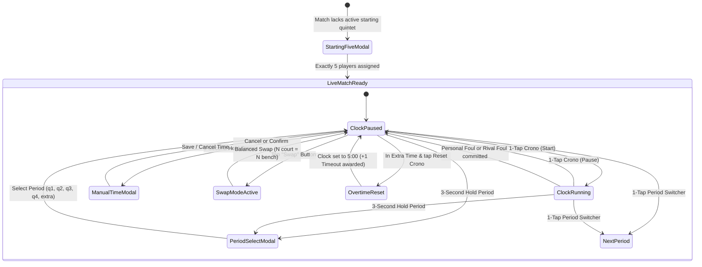

# Data Model: Play Match View

**Feature**: `007-play-match-view` | **Date**: 2026-10-03

## 1. Domain Entities & Database Schema Mapping

### Database Persistence (`games` & `player_stats`)

Managed by Drizzle ORM in `src/db/schema.ts`:

```typescript
// Games Table
export const games = sqliteTable("games", {
  id: integer("id").primaryKey({ autoIncrement: true }),
  teamId: integer("team_id").notNull().references(() => teams.id, { onDelete: "cascade" }),
  opponent: text("opponent").notNull(),
  round: text("round").notNull().default("1"),
  date: text("date").notNull(),
  status: text("status").notNull().default("pending"), // "pending" | "inProgress" | "finished"
  createdAt: text("created_at").notNull().$defaultFn(() => new Date().toISOString()),
  resultC1: integer("result_c1").default(0),            // Maps to q1 home score
  resultC2: integer("result_c2").default(0),            // Maps to q2 home score
  resultC3: integer("result_c3").default(0),            // Maps to q3 home score
  resultC4: integer("result_c4").default(0),            // Maps to q4 home score
  resultExtra: integer("result_extra").default(0),      // Maps to extra home score
  resultC1Opponent: integer("result_c1_opponent").default(0), // Maps to q1 rival score
  resultC2Opponent: integer("result_c2_opponent").default(0), // Maps to q2 rival score
  resultC3Opponent: integer("result_c3_opponent").default(0), // Maps to q3 rival score
  resultC4Opponent: integer("result_c4_opponent").default(0), // Maps to q4 rival score
  resultExtraOpponent: integer("result_extra_opponent").default(0), // Maps to extra rival score
});

// Player Stats Table
export const playerStats = sqliteTable("player_stats", {
  id: integer("id").primaryKey({ autoIncrement: true }),
  gameId: integer("game_id").notNull().references(() => games.id, { onDelete: "cascade" }),
  playerId: integer("player_id").notNull().references(() => players.id, { onDelete: "cascade" }),
  minutes: integer("minutes").default(0),
  t1a: integer("t1a").default(0),
  t1i: integer("t1i").default(0),
  t2a: integer("t2a").default(0),
  t2i: integer("t2i").default(0),
  t3a: integer("t3a").default(0),
  t3i: integer("t3i").default(0),
  oreb: integer("oreb").default(0),
  dreb: integer("dreb").default(0),
  asis: integer("asis").default(0),
  rec: integer("rec").default(0),   // Steals / Ball recuperation
  per: integer("per").default(0),   // Turnovers / Ball lost
  falt: integer("falt").default(0), // Personal fouls
  valuation: integer("valuation").default(0),
});
```

---

## 2. In-Memory Live Match State (`usePlayMatchStore`)

Managed in the centralized Zustand global state store:

```typescript
export type PeriodKey = "q1" | "q2" | "q3" | "q4" | "extra";

export interface PeriodData {
  key: PeriodKey;
  label: string;             // "Q1", "Q2", "Q3", "Q4", "EXTRA"
  remainingSeconds: number;  // 600 default for Q1-Q4 (10min), 300 for EXTRA (5min)
  teamScore: number;
  rivalScore: number;
  teamFouls: number;
  rivalFouls: number;
  isCompleted: boolean;
}

export interface InGamePlayer {
  id: number;
  firstName: string;
  lastName: string;
  number: string;
  position?: string | null;
  isOnCourt: boolean;
  courtPositionIndex?: number | null; // 0, 1, 2, 3, 4 for the 5 half-court positions
  secondsPlayed: number;
  t1a: number; // 1pt made
  t1i: number; // 1pt missed
  t2a: number; // 2pt made
  t2i: number; // 2pt missed
  t3a: number; // 3pt made
  t3i: number; // 3pt missed
  oreb: number; // Offensive rebound
  dreb: number; // Defensive rebound
  asis: number; // Assists
  rec: number;  // Ball recuperation (steals)
  per: number;  // Ball lost (turnovers)
  falt: number; // Personal fouls
  valuation: number;
}

export interface TimeoutBudget {
  firstHalfRemaining: number;  // Initialized to 2 (shared for q1 & q2)
  secondHalfRemaining: number; // Initialized to 3 (shared for q3 & q4)
  extraTimeRemaining: number;  // Initialized to 1, +1 added per crono reset
}

export interface SwapState {
  isSwapMode: boolean;
  selectedCourtPlayerIds: number[];
  selectedBenchPlayerIds: number[];
}

export interface PlayMatchState {
  matchId: number;
  activePeriod: PeriodKey;
  periods: Record<PeriodKey, PeriodData>;
  isTimerRunning: boolean;
  players: InGamePlayer[];
  timeouts: TimeoutBudget;
  swap: SwapState;
  
  // Computed getters / selectors
  totalTeamScore: () => number;
  totalRivalScore: () => number;
  activeCourtPlayers: () => InGamePlayer[];
  benchPlayers: () => InGamePlayer[];
  currentPeriodData: () => PeriodData;
  availableTimeouts: () => number;
}
```

---

## 3. State Machine & Transitions



### Invariants:
1. **5-Player Quintet Invariant**: `players.filter(p => p.isOnCourt).length === 5` during live play (or 0 during initial pending setup before starting 5 selection).
2. **Clock-Stopped Substitution Invariant**: Swap Mode can only be toggled and committed when `isTimerRunning === false`.
3. **Balanced Substitution Invariant**: Substitutions require `selectedCourtPlayerIds.length === selectedBenchPlayerIds.length` and `selectedCourtPlayerIds.length > 0`.
4. **Score Isolation & Aggregation Invariant**: Each period maintains its own `teamScore` and `rivalScore`. Total scores equal the exact sum of all 5 period scores:
   $$\text{Total Score} = \sum_{p \in \{q1, q2, q3, q4, extra\}} \text{PeriodScore}_p$$
5. **Foul Auto-Stop Invariant**: Any increment to home personal fouls or rival fouls triggers `isTimerRunning = false`.
6. **Timeout Budget Invariant**:
   - `q1` and `q2` share a single pool of 2 timeouts (max 2 used across both periods).
   - `q3` and `q4` share a single pool of 3 timeouts (max 3 used across both periods).
   - `extra` has 1 timeout initially + 1 timeout per extra time crono reset.
   - Available timeouts cannot drop below 0.
7. **Player Points Invariant**:
   $$\text{Player Pts} = (\text{t1a} \times 1) + (\text{t2a} \times 2) + (\text{t3a} \times 3)$$
