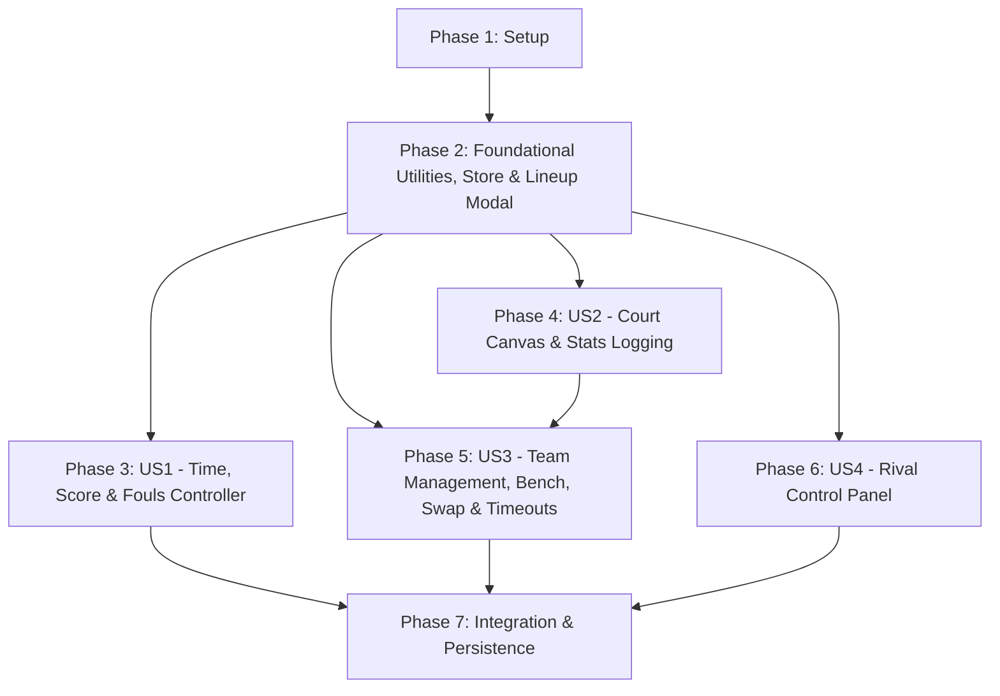

# Tasks: Play Match View

**Input**: Design documents from `/specs/007-play-match-view/`
**Prerequisites**: [plan.md](./plan.md) (required), [spec.md](./spec.md) (required), [research.md](./research.md), [data-model.md](./data-model.md), [contracts/play-match-contracts.ts](./contracts/play-match-contracts.ts), [quickstart.md](./quickstart.md)
**Constitution Compliance**: Principle I (TDD First - Jest & React Native Testing Library), Principle II (Feature-Based Architecture in `src/features/play-match/`), Principle III (Drizzle ORM & Expo SQLite), Principle IV (Zustand Global State), Principle V (NativeWind utility styling), Principle VI (Strict TypeScript).

**Organization**: Tasks are grouped by user story to enable independent implementation and testing of each story adhering to Test-Driven Development (TDD) as mandated by the project constitution.

## Format: `[ID] [P?] [Story] Description`

- **[P]**: Can run in parallel (different files, no dependencies)
- **[Story]**: Which user story this task belongs to (`[US1]`, `[US2]`, `[US3]`, `[US4]`)
- Exact file paths are included in every task description

## Path Conventions

- Mobile app with source at `src/features/play-match/` and feature co-located test suites at `src/features/play-match/__tests__/`

---

## Phase 1: Setup (Shared Infrastructure)

**Purpose**: Establish feature directory structure and synchronize public contracts and type declarations.

- [X] T001 Initialize and verify feature directories in `src/features/play-match/` (`components/`, `store/`, `utils/`, `types/`, and `__tests__/`)
- [X] T002 [P] Re-export feature contracts and types in `src/features/play-match/types/index.ts` referencing `specs/007-play-match-view/contracts/play-match-contracts.ts`

---

## Phase 2: Foundational (Blocking Prerequisites)

**Purpose**: Core utilities, state store, and initial lineup selection modal that MUST be complete before user story components can be implemented.

**⚠️ CRITICAL**: Foundational utilities, store actions, and lineup validation block all live match user stories.

- [X] T003 [P] Unit tests for player identifier formatting in `src/features/play-match/__tests__/utils/formatPlayerIdentifier.test.ts` covering jersey number priority, fallback abbreviation `[First Initial]. [Last Name]`, and edge cases (missing first/last name, extra whitespace, `"Jugador"`)
- [X] T004 Implement `formatPlayerIdentifier` pure utility function in `src/features/play-match/utils/formatPlayerIdentifier.ts`
- [X] T005 [P] Unit tests for centralized Zustand store in `src/features/play-match/__tests__/store/usePlayMatchStore.test.ts` asserting period state (`q1`-`extra`), period isolation, chronometer toggle & 3s manual set, live minute accumulation, player stats mutations, assist flow, balanced swap rules, and phase-based timeout quotas
- [X] T006 Implement and verify centralized Zustand store in `src/features/play-match/store/usePlayMatchStore.ts`
- [X] T007 [P] Unit tests for starting five selection modal in `src/features/play-match/__tests__/components/StartingFiveModal.test.tsx` verifying exact 5-player selection constraint
- [X] T008 Implement `StartingFiveModal` component in `src/features/play-match/components/StartingFiveModal.tsx`

**Checkpoint**: Foundation ready - player identifier utility, state store, and lineup modal verified with tests.

---

## Phase 3: User Story 1 - Game Clock, Period Control & Isolated Period Scoring (Priority: P1) 🎯 MVP

**Goal**: Deliver Component 1 (Time, Score & Fouls Controller) with 1-tap period advance, 3s long-press period selection modal, 1-tap crono toggle, 3s long-press manual time modal, extra time reset preserving scores/fouls (+1 timeout), period isolation, and total score aggregation.

**Independent Test**: Can be tested independently by running `TimeScoreFoulsController.test.tsx` and verifying 1-tap period advancement, 3s hold period modal, 1-tap timer start/stop, 3s hold manual time adjustment, and extra time crono reset (+1 timeout).

### Tests for User Story 1 (TDD First) ⚠️

> **NOTE: Write these tests FIRST, ensure they FAIL before implementation**

- [X] T009 [P] [US1] Unit and interaction tests for `PeriodSelectModal` in `src/features/play-match/__tests__/components/PeriodSelectModal.test.tsx` (all periods listed, direct period selection)
- [X] T010 [P] [US1] Unit and interaction tests for `ManualTimeModal` in `src/features/play-match/__tests__/components/ManualTimeModal.test.tsx` (remaining duration bounds, manual time configuration)
- [X] T011 [P] [US1] Component tests for `TimeScoreFoulsController` in `src/features/play-match/__tests__/components/TimeScoreFoulsController.test.tsx` (1-tap period advance, 3s hold modal trigger, 1-tap crono toggle, 3s hold manual time trigger, extra time reset preserving scores/fouls and granting +1 timeout)

### Implementation for User Story 1

- [X] T012 [P] [US1] Implement `PeriodSelectModal` component in `src/features/play-match/components/PeriodSelectModal.tsx`
- [X] T013 [P] [US1] Implement `ManualTimeModal` component in `src/features/play-match/components/ManualTimeModal.tsx`
- [X] T014 [US1] Implement `TimeScoreFoulsController` (Component 1) in `src/features/play-match/components/TimeScoreFoulsController.tsx` (integrates period gestures, crono gestures, score/foul displays, and extra time reset)

**Checkpoint**: Component 1 is fully functional and testable independently.

---

## Phase 4: User Story 2 - Court Canvas & Player In-Game Statistics Logging (Priority: P1)

**Goal**: Deliver Component 2's interactive half-court canvas with 5 position buttons, empty position tap quick player assignment, player circle display (exclusively jersey number if present, or fallback `[First Initial]. [Last Name]`, divisor line, and `${min}min / ${pts}pts`), stats modal (`t1a`, `t1i`, `t2a`, `t2i`, `t3a`, `t3i`), assist prompt for `t2a`/`t3a` ("non assistant"), offensive/defensive rebounds, personal fouls with period team foul increment & crono auto-stop, and live player minutes tracking.

**Independent Test**: Can be tested independently by running `HalfCourtCanvas.test.tsx` and `PlayerStatsModal.test.tsx` to verify position buttons, player circle formatting (jersey exclusivity & fallback), stats recording, assist teammate routing, and foul clock stoppage.

### Tests for User Story 2 (TDD First) ⚠️

- [X] T015 [P] [US2] Component tests for `QuickAssignPlayerModal` in `src/features/play-match/__tests__/components/QuickAssignPlayerModal.test.tsx` (bench player quick assignment to empty slot)
- [X] T016 [P] [US2] Component tests for `PlayerStatsModal` in `src/features/play-match/__tests__/components/PlayerStatsModal.test.tsx` (shooting make/miss options, assist prompt on t2a/t3a with "non assistant", offensive/defensive rebounds, personal foul clock stoppage)
- [X] T017 [P] [US2] Component tests for `HalfCourtCanvas` in `src/features/play-match/__tests__/components/HalfCourtCanvas.test.tsx` (rendering 5 position buttons, player representation circles asserting jersey number exclusivity, fallback `[First Initial]. [Last Name]`, and empty slot tap behavior)

### Implementation for User Story 2

- [X] T018 [P] [US2] Implement `QuickAssignPlayerModal` in `src/features/play-match/components/QuickAssignPlayerModal.tsx` (for tapping empty court position buttons)
- [X] T019 [P] [US2] Implement `PlayerStatsModal` in `src/features/play-match/components/PlayerStatsModal.tsx` (multi-step stats modal with shooting options, assist selector, rebounds, and fouls)
- [X] T020 [US2] Implement `HalfCourtCanvas` in `src/features/play-match/components/HalfCourtCanvas.tsx` (half basketball court canvas with 5 interactive position buttons using `formatPlayerIdentifier` for player circle identification)

**Checkpoint**: Half-court canvas and player statistics logging are fully functional and testable independently.

---

## Phase 5: User Story 3 - Team Management, Bench, Swap Mode & Timeout Control (Priority: P2)

**Goal**: Deliver Component 2's bottom team panel with horizontal bench list (player circles using `formatPlayerIdentifier`), "Swap" button activating balanced substitution mode ($N\text{ in} = N\text{ out}$) with clock-stopped constraint, and timeout increase/decrease controls enforcing quota rules (2 for `q1`-`q2`, 3 for `q3`-`q4`, 1 for `extra` + resets).

**Independent Test**: Can be tested independently by running `TeamManagementPanel.test.tsx` and verifying bench circle rendering (jersey number exclusivity & fallback), Swap mode equal-count enforcement, clock-running substitution prevention, and timeout quota limits.

### Tests for User Story 3 (TDD First) ⚠️

- [X] T021 [P] [US3] Component tests for `TeamManagementPanel` in `src/features/play-match/__tests__/components/TeamManagementPanel.test.tsx` (horizontal bench list with jersey exclusivity & fallback name display, Swap mode equal-count rules, clock-stopped restriction, timeout increase/decrease and quotas)

### Implementation for User Story 3

- [X] T022 [US3] Implement `TeamManagementPanel` in `src/features/play-match/components/TeamManagementPanel.tsx` (horizontal bench list with `formatPlayerIdentifier`, Swap button, and timeout controls spaced in the same row)
- [X] T023 [US3] Implement `TeamManagementCanvas` container in `src/features/play-match/components/TeamManagementCanvas.tsx` (combines `HalfCourtCanvas` and `TeamManagementPanel` into Component 2)

**Checkpoint**: Component 2 (Court Canvas + Team Management Panel) is complete and testable independently.

---

## Phase 6: User Story 4 - Rival Control Panel (Priority: P2)

**Goal**: Deliver Component 3 (Rival Panel Control) with quick adjustment buttons for rival period score (+1, +2, +3, -1) and rival period team fouls (+1, -1, with +1 automatically pausing the chronometer).

**Independent Test**: Can be tested independently by running `RivalPanelControl.test.tsx` and asserting that rival points/fouls update active period state, update total rival score, and +1 foul pauses the running timer.

### Tests for User Story 4 (TDD First) ⚠️

- [X] T024 [P] [US4] Component tests for `RivalPanelControl` in `src/features/play-match/__tests__/components/RivalPanelControl.test.tsx` (score buttons +1/+2/+3/-1, foul buttons +1/-1, clock auto-stop on foul)

### Implementation for User Story 4

- [X] T025 [US4] Implement `RivalPanelControl` (Component 3) in `src/features/play-match/components/RivalPanelControl.tsx`

**Checkpoint**: Component 3 is complete and testable independently.

---

## Phase 7: Polish & Cross-Cutting Concerns

**Purpose**: Wire all 3 components into the main `PlayMatch` page, synchronize state persistence with SQLite (`games` and `player_stats`), and validate all quickstart scenarios.

- [X] T026 [P] Integration tests for `PlayMatch` screen in `src/features/play-match/__tests__/page/PlayMatch.test.tsx` validating full game flow across all 3 components, application header live score formatting `${teamName} ${teamTotalScore} - ${rivalTotalScore} ${rivalName}`, and player circle display
- [X] T027 Implement `PlayMatch` container in `src/features/play-match/PlayMatch.tsx` and re-export in `src/features/play-match/index.ts` and `src/page/PlayMatch.tsx` with header score display and Drizzle SQLite persistence on game events / finish
- [X] T028 [P] Documentation updates in `specs/007-play-match-view/` reflecting implementation status and player identifier formatting rules
- [X] T029 Run full TypeScript verification (`npx tsc --noEmit`) and Jest test suite (`npm test`) across all play-match unit and component tests
- [X] T030 Validate end-to-end functionality against all 9 validation scenarios in `specs/007-play-match-view/quickstart.md`

---

## Dependencies & Execution Order

### Phase Dependencies

- **Setup (Phase 1)**: No dependencies — can start immediately.
- **Foundational (Phase 2)**: Depends on Setup — BLOCKS all user stories.
- **User Story 1 (Phase 3)**: Depends on Foundational (Phase 2).
- **User Story 2 (Phase 4)**: Depends on Foundational (Phase 2).
- **User Story 3 (Phase 5)**: Depends on Foundational (Phase 2) and integrates with User Story 2.
- **User Story 4 (Phase 6)**: Depends on Foundational (Phase 2).
- **Polish & Integration (Phase 7)**: Depends on all User Stories (Phases 3–6) complete.

### User Story Dependencies



### Within Each User Story

- Tests MUST be written and fail before implementation (TDD Red-Green-Refactor).
- Modals and child components before parent containers.
- Core gestures/buttons before integrations.
- User Story independently testable before proceeding to the next priority.

### Parallel Opportunities

- **Phase 1**: T001 and T002 can run in parallel.
- **Phase 2**: T003 (identifier utility tests), T005 (store tests), and T007 (lineup modal tests) can run in parallel.
- **Phase 3 (US1)**: T009, T010, and T011 test files can run in parallel; T012 and T013 modals can run in parallel.
- **Phase 4 (US2)**: T015, T016, and T017 test files can run in parallel; T018 and T019 modals can run in parallel.
- **Phase 5 (US3) & Phase 6 (US4)**: US3 and US4 can proceed in parallel once Phase 2 is complete.

---

## Parallel Example: User Story 1

```bash
# Launch test suites for User Story 1 together:
Task: "Unit and interaction tests for PeriodSelectModal in src/features/play-match/__tests__/components/PeriodSelectModal.test.tsx"
Task: "Unit and interaction tests for ManualTimeModal in src/features/play-match/__tests__/components/ManualTimeModal.test.tsx"
Task: "Component tests for TimeScoreFoulsController in src/features/play-match/__tests__/components/TimeScoreFoulsController.test.tsx"

# Implement child modals in parallel:
Task: "Implement PeriodSelectModal component in src/features/play-match/components/PeriodSelectModal.tsx"
Task: "Implement ManualTimeModal component in src/features/play-match/components/ManualTimeModal.tsx"
```

## Parallel Example: User Story 2

```bash
# Launch test suites for User Story 2 together:
Task: "Component tests for QuickAssignPlayerModal in src/features/play-match/__tests__/components/QuickAssignPlayerModal.test.tsx"
Task: "Component tests for PlayerStatsModal in src/features/play-match/__tests__/components/PlayerStatsModal.test.tsx"
Task: "Component tests for HalfCourtCanvas in src/features/play-match/__tests__/components/HalfCourtCanvas.test.tsx"

# Implement sub-modals in parallel:
Task: "Implement QuickAssignPlayerModal in src/features/play-match/components/QuickAssignPlayerModal.tsx"
Task: "Implement PlayerStatsModal in src/features/play-match/components/PlayerStatsModal.tsx"
```

---

## Implementation Strategy

### MVP First (User Story 1 Only)

1. Complete Phase 1: Setup (T001–T002)
2. Complete Phase 2: Foundational (T003–T008)
3. Complete Phase 3: User Story 1 (T009–T014)
4. **STOP and VALIDATE**: Run `TimeScoreFoulsController` tests to confirm timer, period transitions, and period score isolation.

### Incremental Delivery

1. Complete Setup + Foundational (`formatPlayerIdentifier`, `usePlayMatchStore`, `StartingFiveModal`) with 100% unit test coverage.
2. Deliver Component 1 (`TimeScoreFoulsController`) -> Test independently (MVP!).
3. Deliver Component 2 (`HalfCourtCanvas` + `PlayerStatsModal` + `TeamManagementPanel`) with jersey number priority and fallback formatting -> Test independently.
4. Deliver Component 3 (`RivalPanelControl`) -> Test independently.
5. Deliver `PlayMatch` root integration with SQLite persistence and header score display -> Execute `quickstart.md` scenarios.

### Parallel Team Strategy

With multiple developers:
1. Team completes Setup + Foundational together.
2. Once Foundational is done:
   - Developer A: User Story 1 (Clock, Period Control & Scoring)
   - Developer B: User Story 2 (Court Canvas, Player Stats & Identification)
   - Developer C: User Story 3 (Bench, Swap Mode & Timeouts)
   - Developer D: User Story 4 (Rival Panel Control)
3. Integrate in Phase 7.

---

## Notes

- `[P]` tasks = different files, no dependencies
- `[Story]` label maps task to specific user story for traceability
- Strict checklist format `- [ ] [TaskID] [P?] [Story?] Description with file path` enforced on all tasks
- TDD Red-Green-Refactor strictly adhered to per Constitution Principle I
- Stop at any checkpoint to validate story independently
