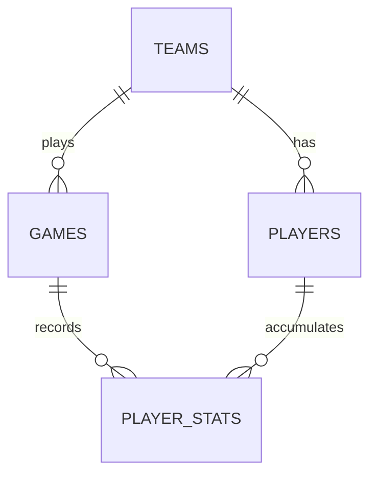

# Data Model: Remove Training Session

**Feature Branch**: `008-remove-training-session`  
**Date**: 2026-10-22  
**Status**: Completed  

---

## 1. Overview of Changes

This feature removes all training entities, relationships, and tables from the application while strictly preserving teams, players, games, and match statistics.

| Entity | Previous Status | New Status | Description |
|--------|----------------|------------|-------------|
| `teams` | Retained (1:N with trainings) | **Retained** | All former training relations removed. Roster & game links preserved. |
| `players` | Retained (1:N with trainingPlayers) | **Retained** | All former attendance relations removed. Player profiles & stats preserved. |
| `games` | Retained | **Retained** | Fully intact. Zero changes to games or quarter results. |
| `player_stats` | Retained | **Retained** | Fully intact. Live and accumulated match statistics preserved. |
| `trainings` | Active | **DROPPED** | Table dropped from SQLite; entity removed from Drizzle schema & TS types. |
| `training_players` | Active | **DROPPED** | Table dropped from SQLite; entity removed from Drizzle schema & TS types. |

---

## 2. Retained Entities & Relations



### 2.1 `teams` Schema
```typescript
export const teams = sqliteTable("teams", {
  id: integer("id").primaryKey({ autoIncrement: true }),
  name: text("name").notNull(),
  category: text("category"),
  createdAt: text("created_at")
    .notNull()
    .$defaultFn(() => new Date().toISOString()),
});

export const teamsRelations = relations(teams, ({ many }) => ({
  players: many(players),
  games: many(games),
  // REMOVED: trainings
}));
```

### 2.2 `players` Schema
```typescript
export const players = sqliteTable("players", {
  id: integer("id").primaryKey({ autoIncrement: true }),
  teamId: integer("team_id")
    .notNull()
    .references(() => teams.id, { onDelete: "cascade" }),
  firstName: text("first_name").notNull(),
  lastName: text("last_name").notNull(),
  number: text("number").notNull(),
  position: text("position"),
  notes: text("notes"),
  createdAt: text("created_at")
    .notNull()
    .$defaultFn(() => new Date().toISOString()),
});

export const playersRelations = relations(players, ({ one, many }) => ({
  team: one(teams, {
    fields: [players.teamId],
    references: [teams.id],
  }),
  playerStats: many(playerStats),
  // REMOVED: trainingPlayers
}));
```

### 2.3 `games` Schema (Unchanged)
Remains 1:N with `playerStats` and N:1 with `teams`.

### 2.4 `player_stats` Schema (Unchanged)
Remains N:1 with `games` and N:1 with `players`.

---

## 3. Dropped Entities

### 3.1 `trainings` (Dropped)
- **Table Name**: `trainings`
- **Columns Removed**:
  - `id` (INTEGER PRIMARY KEY)
  - `team_id` (INTEGER)
  - `training_number` (INTEGER)
  - `date` (TEXT)
  - `warmup1`..`warmup3` & explanations (TEXT)
  - `exercise1`..`exercise6` & explanations (TEXT)
  - `cooldown1`..`cooldown2` & explanations (TEXT)

### 3.2 `training_players` (Dropped)
- **Table Name**: `training_players`
- **Columns Removed**:
  - `id` (INTEGER PRIMARY KEY)
  - `training_id` (INTEGER)
  - `player_id` (INTEGER)
  - `attended` (INTEGER)
  - `notes` (TEXT)

---

## 4. SQLite Schema Transition & Migration Order

When `initDatabase()` executes on application startup:

1. Enable foreign keys and WAL mode:
   ```sql
   PRAGMA foreign_keys = ON;
   PRAGMA journal_mode = WAL;
   ```
2. Purge training tables if they exist (child table dropped first to prevent foreign key errors):
   ```sql
   DROP TABLE IF EXISTS training_players;
   DROP TABLE IF EXISTS trainings;
   ```
3. Create core domain tables if they do not exist (`teams`, `players`, `games`, `player_stats`).
4. Result:
   - Existing databases have training tables dropped cleanly without touching team or player rows.
   - Fresh database installations never create training tables.

---

## 5. Validation Rules & Data Integrity

- **Cascading Deletions**: Deleting a team cascades deletions strictly to `players`, `games`, and `player_stats`.
- **Player Deletions**: Deleting a player cascades deletions strictly to `player_stats`.
- **Zero Orphan Foreign Keys**: No remaining table in the database contains foreign keys pointing to dropped training tables.
