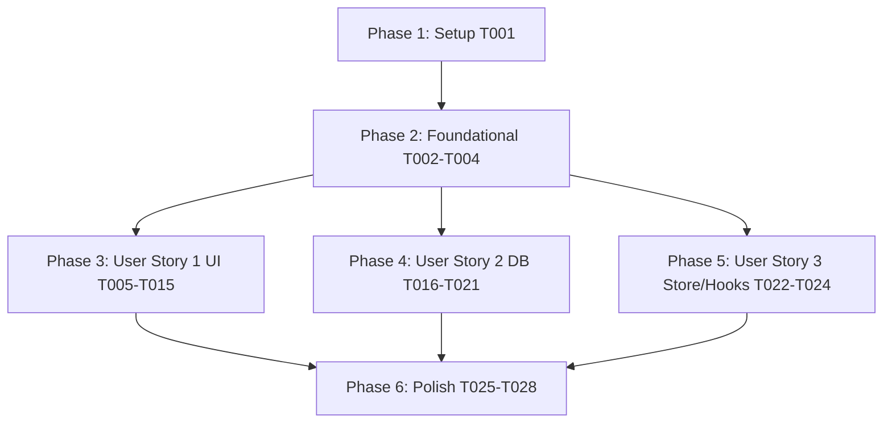

# Tasks: Remove Training Session

**Input**: Design documents from `specs/008-remove-training-session/`
**Prerequisites**: [plan.md](file:///j:/GitHub/BasketApp/bcmApp/specs/008-remove-training-session/plan.md), [spec.md](file:///j:/GitHub/BasketApp/bcmApp/specs/008-remove-training-session/spec.md), [data-model.md](file:///j:/GitHub/BasketApp/bcmApp/specs/008-remove-training-session/data-model.md), [research.md](file:///j:/GitHub/BasketApp/bcmApp/specs/008-remove-training-session/research.md), [contracts/](file:///j:/GitHub/BasketApp/bcmApp/specs/008-remove-training-session/contracts/), [quickstart.md](file:///j:/GitHub/BasketApp/bcmApp/specs/008-remove-training-session/quickstart.md)
**Constitution**: Adheres to [constitution.md](file:///j:/GitHub/BasketApp/bcmApp/.specify/memory/constitution.md) (Principle I: TDD First, Principle II: Feature-Based Architecture, Principle III: Type-Safe Persistence, Principle IV: Zustand State, Principle V: NativeWind, Principle VI: Strict TypeScript)

---

## Format: `- [ ] [ID] [P?] [Story?] Description with file path`

- **[P]**: Can run in parallel (different files, no blocking dependencies on incomplete tasks)
- **[Story]**: Associated user story identifier (`[US1]`, `[US2]`, `[US3]`) - omitted for Setup, Foundational, and Polish phases
- Exact file paths are specified for every task

---

## Phase 1: Setup (Shared Infrastructure)

**Purpose**: Baseline verification of repository environment, dependencies, and test health before making modifications.

- [X] T001 Verify project dependencies and baseline test suite pass rate with `npm test` in [package.json](file:///j:/GitHub/BasketApp/bcmApp/package.json)

---

## Phase 2: Foundational (Blocking Prerequisites)

**Purpose**: Prune obsolete core TypeScript enums, database entity types, and store type definitions that all downstream components, services, and tests depend on.

**⚠️ CRITICAL**: Must complete before starting User Story implementation to ensure clean compiler diagnostics across modules.

- [X] T002 [P] Update navigation enums to remove `TRAINING`, `TRAININGS`, and `ADD_NEW_SESSION` from `TopMenuEnums` per CONTRACT-UI-001 in [src/types/enums.ts](file:///j:/GitHub/BasketApp/bcmApp/src/types/enums.ts)
- [X] T003 [P] Update database entity types to remove `Training`, `NewTraining`, `TrainingPlayer`, and `NewTrainingPlayer` per CONTRACT-DB-001 in [src/types/database.ts](file:///j:/GitHub/BasketApp/bcmApp/src/types/database.ts)
- [X] T004 [P] Update store interface types to remove `TrainingState` per CONTRACT-STORE-001 in [src/types/store.ts](file:///j:/GitHub/BasketApp/bcmApp/src/types/store.ts)

**Checkpoint**: Foundational types sanitized; user story implementation can proceed in parallel.

---

## Phase 3: User Story 1 - Streamlined Navigation and Removal of Training Views (Priority: P1) 🎯 MVP

**Goal**: Remove all training views, forms, list cards, attendance badges, and navigation tabs so users only interact with active club and team features without broken links or residual screens.

**Independent Test**: Navigate through primary menus, team profile, and player detail screens. Verify exactly 4 tabs exist in `ClubProfile` (`Inicio`, `Plantilla`, `Partidos`, `Volver`), zero training cards or screens are accessible, and `PlayerDetail` renders only `P. J` without `E. A` or `E. F` badges.

### Tests for User Story 1

> **NOTE: Update and verify these tests fail or align prior to component implementation per Constitution Principle I (TDD)**

- [X] T005 [P] [US1] Update ClubProfile navigation tests to assert exactly 4 bottom navigation items excluding `TRAININGS` in [src/__tests__/components/ClubProfile.test.tsx](file:///j:/GitHub/BasketApp/bcmApp/src/__tests__/components/ClubProfile.test.tsx)
- [X] T006 [P] [US1] Update Header tests to remove the obsolete `TrainingList Context` test suite in [src/__tests__/components/Header.test.tsx](file:///j:/GitHub/BasketApp/bcmApp/src/__tests__/components/Header.test.tsx)
- [X] T007 [P] [US1] Update BottomNavBar unit test mock items to exclude `TRAININGS` in [src/__tests__/components/BottomNavBar.test.tsx](file:///j:/GitHub/BasketApp/bcmApp/src/__tests__/components/BottomNavBar.test.tsx)
- [X] T008 [P] [US1] Update MenuStore unit tests to remove `TopMenuEnums.TRAININGS` references in [src/__tests__/store/MenuStore.test.ts](file:///j:/GitHub/BasketApp/bcmApp/src/__tests__/store/MenuStore.test.ts)

### Implementation for User Story 1

- [X] T009 [P] [US1] Delete obsolete training list view in [src/page/TrainingList.tsx](file:///j:/GitHub/BasketApp/bcmApp/src/page/TrainingList.tsx)
- [X] T010 [P] [US1] Delete obsolete training cards component in [src/components/TraningCards.tsx](file:///j:/GitHub/BasketApp/bcmApp/src/components/TraningCards.tsx)
- [X] T011 [P] [US1] Delete obsolete training detail component in [src/components/TrainingDetail.tsx](file:///j:/GitHub/BasketApp/bcmApp/src/components/TrainingDetail.tsx)
- [X] T012 [P] [US1] Delete obsolete training form component in [src/components/TrainingForm.tsx](file:///j:/GitHub/BasketApp/bcmApp/src/components/TrainingForm.tsx)
- [X] T013 [P] [US1] Delete obsolete training player attendance component in [src/components/TrainingPlayer.tsx](file:///j:/GitHub/BasketApp/bcmApp/src/components/TrainingPlayer.tsx)
- [X] T014 [US1] Update team bottom navigation bar to exactly 4 items, remove `TrainingList` rendering, and update guidance text per CONTRACT-UI-001 in [src/page/ClubProfile.tsx](file:///j:/GitHub/BasketApp/bcmApp/src/page/ClubProfile.tsx)
- [X] T015 [US1] Remove training attendance badges (`E. A`, `E. F`) and controller invocations while preserving `P. J` badge in [src/components/PlayerDetail.tsx](file:///j:/GitHub/BasketApp/bcmApp/src/components/PlayerDetail.tsx)

**Checkpoint**: User Story 1 functional and independently testable; UI navigation is completely cleansed of training touchpoints.

---

## Phase 4: User Story 2 - Complete Data Purge and Data Store Sanitization (Priority: P1)

**Goal**: Permanently drop `trainings` and `training_players` tables on application launch, remove training schema definitions from Drizzle, and sanitize the seed script while preserving all teams, players, games, and match statistics.

**Independent Test**: Execute database tests to confirm `trainings` and `training_players` schemas are absent, `DROP TABLE IF EXISTS` migration executes on `initDatabase()`, cascading delete rules on retained tables remain intact, and seeding succeeds with 3 teams, 36 players, 21 games, and 0 trainings.

### Tests for User Story 2

- [X] T016 [P] [US2] Update database schema connection test to assert core tables without `trainings` or `trainingPlayers` per CONTRACT-DB-001 in [src/__tests__/db/connection.test.ts](file:///j:/GitHub/BasketApp/bcmApp/src/__tests__/db/connection.test.ts)
- [X] T017 [P] [US2] Update cascade delete tests to verify cascading deletion on teams, players, and games without training references in [src/__tests__/db/cascade.test.ts](file:///j:/GitHub/BasketApp/bcmApp/src/__tests__/db/cascade.test.ts)
- [X] T018 [P] [US2] Update database seed test to assert seed summary returns 0 trainings in [src/__tests__/db/seed.test.ts](file:///j:/GitHub/BasketApp/bcmApp/src/__tests__/db/seed.test.ts)

### Implementation for User Story 2

- [X] T019 [US2] Remove `trainings` and `training_players` table schemas and `many(trainings)` / `many(trainingPlayers)` relations from [src/db/schema.ts](file:///j:/GitHub/BasketApp/bcmApp/src/db/schema.ts)
- [X] T020 [US2] Add `DROP TABLE IF EXISTS training_players; DROP TABLE IF EXISTS trainings;` migration and remove training table creation from `initDatabase()` in [src/db/index.ts](file:///j:/GitHub/BasketApp/bcmApp/src/db/index.ts)
- [X] T021 [US2] Remove training mock data, insertion loops, and table deletions from [scripts/seed-db.ts](file:///j:/GitHub/BasketApp/bcmApp/scripts/seed-db.ts)

**Checkpoint**: User Story 2 complete; persistent local storage automatically drops training tables on startup and seed logic creates only active domain data.

---

## Phase 5: User Story 3 - Elimination of Runtime State and Background Overhead (Priority: P2)

**Goal**: Eliminate the obsolete Zustand training store and data access controllers to free runtime memory and eliminate dead state management code.

**Independent Test**: Verify runtime state initializes without `TrainingStore`, and `useDB()` returns only active controllers (`TeamController`, `PlayerController`, `GameController`, `PlayerStatsController`) without compiler or runtime warnings.

### Tests for User Story 3

- [X] T022 [P] [US3] Delete obsolete legacy training test script in [src/test/trainings.js](file:///j:/GitHub/BasketApp/bcmApp/src/test/trainings.js)

### Implementation for User Story 3

- [X] T023 [P] [US3] Delete obsolete Zustand training store in [src/store/TrainingStore.ts](file:///j:/GitHub/BasketApp/bcmApp/src/store/TrainingStore.ts)
- [X] T024 [US3] Remove `TrainingController`, `TraningPlayersController`, and `TrainingPlayersController` from [src/hooks/useDB.ts](file:///j:/GitHub/BasketApp/bcmApp/src/hooks/useDB.ts)

**Checkpoint**: All three user stories implemented; state management and data hooks operate with zero training overhead.

---

## Phase 6: Polish & Cross-Cutting Concerns

**Purpose**: End-to-end type validation, zero-orphan scan, full regression testing, and quickstart scenario verification across the entire project.

- [X] T025 [P] Run strict TypeScript type check with `npx tsc --noEmit` across all modules in [tsconfig.json](file:///j:/GitHub/BasketApp/bcmApp/tsconfig.json)
- [X] T026 [P] Verify zero remaining training references in `src/` using `git grep -i "training" -- src/` per [specs/008-remove-training-session/quickstart.md](file:///j:/GitHub/BasketApp/bcmApp/specs/008-remove-training-session/quickstart.md)
- [X] T027 Run full test suite with `npm test` to verify 100% pass rate in [package.json](file:///j:/GitHub/BasketApp/bcmApp/package.json)
- [X] T028 Execute manual and automated validation scenarios defined in [specs/008-remove-training-session/quickstart.md](file:///j:/GitHub/BasketApp/bcmApp/specs/008-remove-training-session/quickstart.md)

---

## Dependencies & Execution Order

### Phase Dependencies



- **Setup (Phase 1)**: Independent baseline; can run immediately.
- **Foundational (Phase 2)**: Depends on Phase 1; blocks all User Stories.
- **User Story 1 (Phase 3)**: Depends on Phase 2; can proceed in parallel with or prior to US2 and US3.
- **User Story 2 (Phase 4)**: Depends on Phase 2; can proceed in parallel with US1.
- **User Story 3 (Phase 5)**: Depends on Phase 2; depends on US1 (`PlayerDetail.tsx`) dropping its controller calls before deleting controllers in `useDB.ts`.
- **Polish (Phase 6)**: Runs after Phases 3, 4, and 5 are completed.

### Parallel Opportunities

- **Phase 2 (Foundational)**: T002 (`enums.ts`), T003 (`database.ts`), and T004 (`store.ts`) touch independent files and can run in parallel.
- **Phase 3 (User Story 1 Tests)**: T005 (`ClubProfile.test.tsx`), T006 (`Header.test.tsx`), T007 (`BottomNavBar.test.tsx`), and T008 (`MenuStore.test.ts`) can run in parallel.
- **Phase 3 (User Story 1 Deletions)**: T009 (`TrainingList.tsx`), T010 (`TraningCards.tsx`), T011 (`TrainingDetail.tsx`), T012 (`TrainingForm.tsx`), and T013 (`TrainingPlayer.tsx`) can be deleted in parallel.
- **Phase 4 (User Story 2 Tests)**: T016 (`connection.test.ts`), T017 (`cascade.test.ts`), and T018 (`seed.test.ts`) can run in parallel.
- **Phase 5 (User Story 3)**: T022 (`trainings.js`) and T023 (`TrainingStore.ts`) can run in parallel.
- **Phase 6 (Polish)**: T025 (tsc) and T026 (grep) can run in parallel.

---

## Parallel Example: User Story 1

```bash
# Update all UI test suites in parallel:
npx jest src/__tests__/components/ClubProfile.test.tsx
npx jest src/__tests__/components/Header.test.tsx
npx jest src/__tests__/components/BottomNavBar.test.tsx
npx jest src/__tests__/store/MenuStore.test.ts

# Delete obsolete UI components in parallel:
rm src/page/TrainingList.tsx
rm src/components/TraningCards.tsx
rm src/components/TrainingDetail.tsx
rm src/components/TrainingForm.tsx
rm src/components/TrainingPlayer.tsx
```

---

## Implementation Strategy

### MVP First (User Story 1 Only)

1. Complete Phase 1: Setup (`T001`).
2. Complete Phase 2: Foundational (`T002` - `T004`).
3. Complete Phase 3: User Story 1 (`T005` - `T015`).
4. **STOP and VALIDATE**: Verify UI compiles without training buttons, tabs, or screens.

### Incremental Delivery

1. **Increment 1 (MVP)**: Clean UI navigation (US1) - users no longer encounter training screens.
2. **Increment 2**: Database sanitization (US2) - SQLite tables dropped and seed scripts cleaned.
3. **Increment 3**: State store & hook removal (US3) - `TrainingStore` and `useDB` controllers deleted.
4. **Increment 4**: Full verification (Polish) - strict `tsc`, zero-orphan grep, and 100% Jest test pass.
