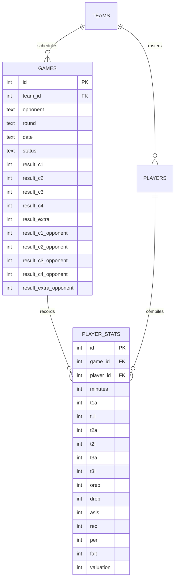
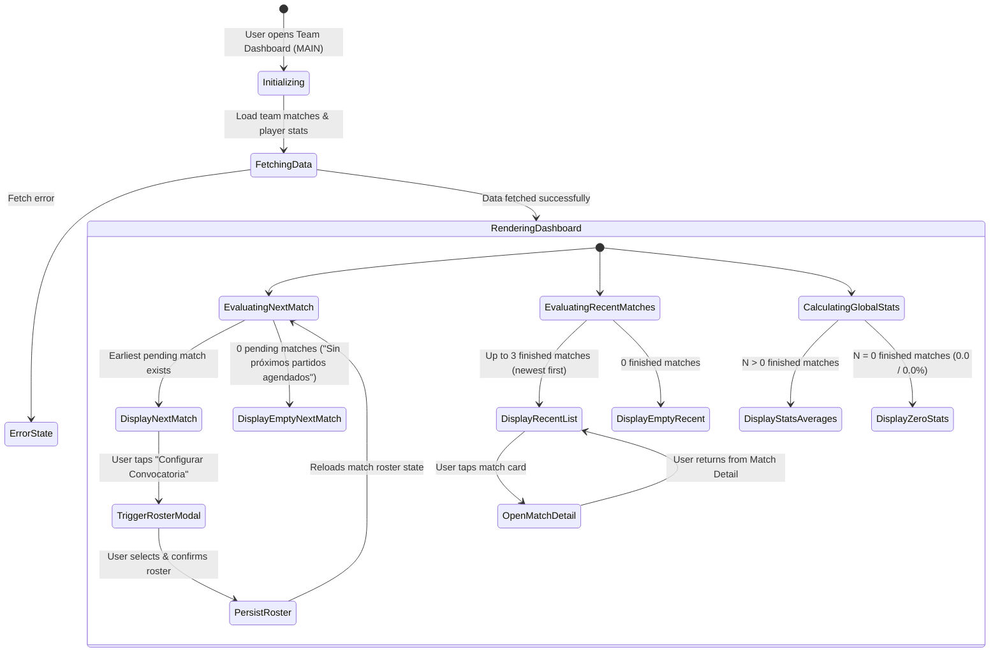

# Data Model: Update Home View Page

**Feature**: `011-update-home-view`
**Date**: 2026-10-23
**Status**: Completed

---

## 1. Domain Entities & Schemas

### 1.1 NextMatchEntry (View Model)

Represents the upcoming fixture displayed in the top section of the home view.

| Field | Type | Description | Validation / Constraints |
|---|---|---|---|
| `id` | `number` | Unique identifier of the game | Primary Key (matches `games.id`) |
| `teamId` | `number` | Foreign key referencing the active team | Non-null, references `teams.id` |
| `opponent` | `string` | Name of the opposing team | Non-empty string |
| `date` | `string` | Scheduled timestamp of the match | e.g. `"15/10/2026 - 19:30"` or ISO format |
| `round` | `string` | Competition round or jornada number | Defaults to `"1"` |
| `status` | `"pending"` | Match state | Must be `"pending"` (not yet started/finished) |
| `hasRoster` | `boolean` | Indicates if player callups have been configured | `true` if $\ge 1$ player assigned in `player_stats` |

---

### 1.2 RecentMatchSummary (View Model)

Represents a completed game shown in the middle vertical history column.

| Field | Type | Description | Validation / Constraints |
|---|---|---|---|
| `id` | `number` | Unique identifier of the game | Primary Key (matches `games.id`) |
| `teamId` | `number` | Foreign key referencing the active team | References `teams.id` |
| `opponent` | `string` | Name of the opposing team | Non-empty string |
| `date` | `string` | Date/time when the match was played | Formatted timestamp string |
| `round` | `string` | Competition round | e.g. `"Jornada 2"` |
| `status` | `"finished"` | Match state | Must be `"finished"` |
| `teamTotalScore` | `number` | Total cumulative score for the active team | Sum of Q1..Q4 + Extra ($\ge 0$) |
| `rivalTotalScore` | `number` | Total cumulative score for the opponent | Sum of Q1..Q4 + Extra ($\ge 0$) |
| `isWinning` | `boolean` | Whether active team won the game | `teamTotalScore > rivalTotalScore` |
| `periods` | `PeriodScoreItem[]` | Breakdown of quarter-by-quarter points | Array of 4 regulation periods + optional Extra |

---

### 1.3 PeriodScoreItem (View Model)

Represents a single quarter or overtime period score for a finished game.

| Field | Type | Description | Constraints |
|---|---|---|---|
| `period` | `"Q1" \| "Q2" \| "Q3" \| "Q4" \| "OT"` | Period identifier | String enum |
| `teamScore` | `number` | Points scored by active team in period | $\ge 0$ |
| `rivalScore` | `number` | Points scored by rival team in period | $\ge 0$ |

---

### 1.4 GlobalTeamAverages (Analytics Entity)

Represents the aggregated arithmetic mean of the eight advanced metrics across all completed matches for the team.

| Field | Type | Unit | Formula | Division-by-Zero Fallback |
|---|---|---|---|---|
| `posesiones` | `number` | count | $\frac{1}{N} \sum \text{Posesiones}_i$ | `0.0` |
| `oer` | `number` | pts / 100 poss | $\frac{1}{N} \sum \text{OER}_i$ | `0.0` |
| `der` | `number` | pts / 100 poss | $\frac{1}{N} \sum \text{DER}_i$ | `0.0` |
| `efg` | `number` | % | $\frac{1}{N} \sum \text{eFG\%}_i$ | `0.0%` |
| `orb` | `number` | % | $\frac{1}{N} \sum \text{ORB\%}_i$ | `0.0%` |
| `ast` | `number` | % | $\frac{1}{N} \sum \text{AST\%}_i$ | `0.0%` |
| `tov` | `number` | % | $\frac{1}{N} \sum \text{TOV\%}_i$ | `0.0%` |
| `ftr` | `number` | % | $\frac{1}{N} \sum \text{FTR}_i$ | `0.0%` |
| `completedMatchesCount` | `number` | integer | $N$ (Total games with `status === "finished"`) | `0` |

---

## 2. Relationships & Entity-Relationship Mapping

---

## 3. State Lifecycle & Transitions

---
