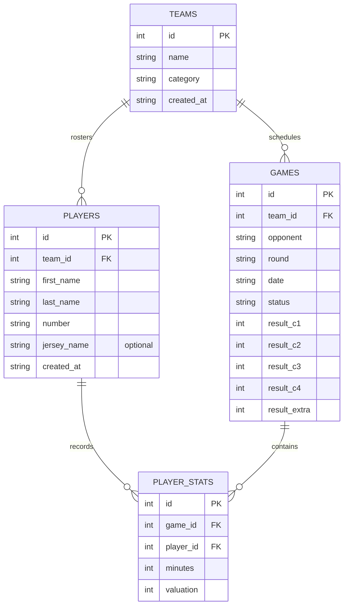

# Data Model: Update Player Contract, Form, and Details

## 1. Entity Definitions

### 1.1 Player Entity

Represents an athlete registered to a club/team. Obsolete fields `position` and `notes` are removed, and `jerseyName` is added as an optional customization string.

#### Table: `players`
| Column | Type | Constraints | Description |
|---|---|---|---|
| `id` | INTEGER | PRIMARY KEY, AUTOINCREMENT | Unique player identifier |
| `team_id` | INTEGER | NOT NULL, FOREIGN KEY -> `teams(id)` ON DELETE CASCADE | ID of the team to which the player belongs |
| `first_name` | TEXT | NOT NULL | Player's first name |
| `last_name` | TEXT | NOT NULL | Player's surname / family name |
| `number` | TEXT | NOT NULL | Jersey number (e.g., "7", "00", "23") |
| `jersey_name` | TEXT | NULLABLE (DEFAULT NULL) | Optional custom name on back of jersey (e.g., "M. JORDAN") |
| `created_at` | TEXT | NOT NULL, DEFAULT `(datetime('now'))` | ISO timestamp of record creation |

*Removed Columns*:
- `position` (formerly `TEXT`)
- `notes` (formerly `TEXT`)

#### TypeScript Representation
```typescript
export interface Player {
  id: number;
  teamId: number;
  firstName: string;
  lastName: string;
  number: string;
  jerseyName?: string | null;
  createdAt: string;
}

export interface NewPlayer {
  teamId: number;
  firstName: string;
  lastName: string;
  number: string;
  jerseyName?: string | null;
}
```

---

### 1.2 Played Match Summary (Derived Entity)

Represents a fixture where a specific player has logged game participation or box score statistics. Used for rendering the played matches list under the player's global statistics.

#### Fields
| Field | Type | Description |
|---|---|---|
| `gameId` | number | Unique identifier of the match |
| `opponent` | string | Name of the rival/opponent team |
| `round` | string | Round or fixture stage (e.g., "1", "Ronda 3", "Jornada 5") |
| `date` | string | Match scheduled date/time string |
| `status` | string | Match status (`"pending"` or `"finished"`) |
| `teamScore` | number | Accumulated score of the player's team |
| `opponentScore` | number | Accumulated score of the opponent team |
| `minutes` | number (optional) | Minutes played in this specific match |
| `points` | number (optional) | Total points scored in this match |
| `valuation` | number (optional) | Efficiency / valuation rating in this match |

---

### 1.3 Player Stats Relationship (`player_stats`)

Associates a player with a game and tracks detailed per-game statistics.

#### Table: `player_stats` (Existing, unchanged schema)
| Column | Type | Constraints | Description |
|---|---|---|---|
| `id` | INTEGER | PRIMARY KEY, AUTOINCREMENT | Unique stat row ID |
| `game_id` | INTEGER | NOT NULL, FOREIGN KEY -> `games(id)` ON DELETE CASCADE | Target match |
| `player_id` | INTEGER | NOT NULL, FOREIGN KEY -> `players(id)` ON DELETE CASCADE | Associated player |
| `minutes` | INTEGER | DEFAULT 0 | Minutes played |
| `t1a`, `t1i` | INTEGER | DEFAULT 0 | Free throws made / missed |
| `t2a`, `t2i` | INTEGER | DEFAULT 0 | 2-point shots made / missed |
| `t3a`, `t3i` | INTEGER | DEFAULT 0 | 3-point shots made / missed |
| `oreb`, `dreb` | INTEGER | DEFAULT 0 | Offensive / defensive rebounds |
| `asis` | INTEGER | DEFAULT 0 | Assists |
| `rec`, `per` | INTEGER | DEFAULT 0 | Steals / turnovers |
| `falt` | INTEGER | DEFAULT 0 | Personal fouls committed |
| `valuation` | INTEGER | DEFAULT 0 | PIR valuation metric |

---

## 2. Entity Relationships (ER Diagram)



---

## 3. Validation Rules

### Player Creation & Updates
1. `firstName`: Must be a non-empty string after trimming (`length > 0`).
2. `lastName`: Must be a non-empty string after trimming (`length > 0`).
3. `number`: Must be a non-empty valid numeric string (e.g. `"0"`, `"23"`, `"99"`).
4. `jerseyName`: Optional.
   - If provided: length must be between 1 and 30 characters. Trim leading/trailing whitespace.
   - If omitted or empty: stored as `null` or empty string. Must not cause validation errors.
5. `position`: Disallowed. No validation or presence in submitted payloads.
6. `notes`: Disallowed. No validation or presence in submitted payloads.

### Played Matches Query
1. Matches are included if a corresponding `player_stats` row exists for `playerId`.
2. Fallback round: If `round` is undefined or empty string, default to `"1"`.
3. Fallback empty state: If query returns 0 items, display an empty state placeholder rather than an empty list or broken container.

---

## 4. State Transitions

### Player Form State
- **Initial**: Blank inputs for create; populated inputs (`firstName`, `lastName`, `number`, `jerseyName`) for edit.
- **Validation**: On submit, validate `firstName`, `lastName`, and `number`. `jerseyName` requires no presence check.
- **Persisted**: Drizzle ORM inserts/updates `players` record in SQLite; Zustand store updates `playersList`.

### Player Detail Navigation State
- **Viewing Detail**: `selectedMatch = null`. `PlayerDetail` shows player summary card, global stats card, and played matches list.
- **Inspect Match**: User taps action button on played match -> `selectedMatch = matchRecord`. View transitions to `<MatchDetailView match={selectedMatch} />`.
- **Return to Detail**: User taps return/back button in `MatchDetailView` -> `selectedMatch = null`. View transitions back to `PlayerDetail` without lost scroll or player state.
