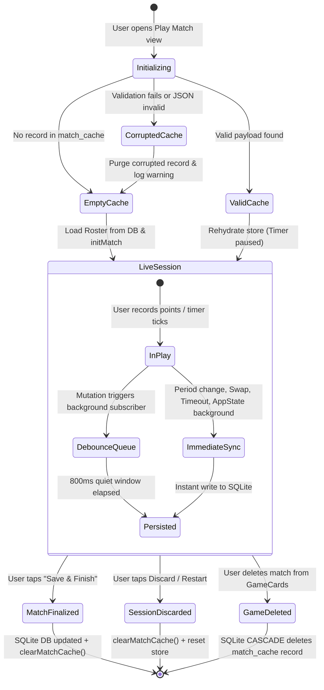

# Data Model: Play Match Background Caching

**Feature**: Caching the Play Match  
**Feature Branch**: `015-cache-play-match`  
**Status**: Completed  
**Date**: 2026-10-25  

---

## 1. Relational Entities (SQLite / Drizzle ORM)

### `match_cache` Table Schema
Represents the local database entity storing the temporary state of an in-progress match session.

| Column | SQLite Type | Drizzle Mode / Constraints | Description |
|---|---|---|---|
| `id` | `INTEGER` | `primaryKey({ autoIncrement: true })` | Unique cache entry surrogate key |
| `match_id` | `INTEGER` | `notNull().unique().references(() => games.id, { onDelete: 'cascade' })` | Associated game ID; auto-deletes on game removal |
| `state_json` | `TEXT` | `notNull()` | Serialized JSON containing `CachedMatchPayload` |
| `version` | `INTEGER` | `notNull().default(1)` | Schema version of cache structure |
| `last_updated` | `TEXT` | `notNull()` | ISO-8601 timestamp of last cache update |

#### Drizzle Schema Definition
```typescript
import { sqliteTable, text, integer } from "drizzle-orm/sqlite-core";
import { games } from "../../../db/schema";

export const matchCache = sqliteTable("match_cache", {
  id: integer("id").primaryKey({ autoIncrement: true }),
  matchId: integer("match_id")
    .notNull()
    .unique()
    .references(() => games.id, { onDelete: "cascade" }),
  stateJson: text("state_json").notNull(),
  version: integer("version").notNull().default(1),
  lastUpdated: text("last_updated")
    .notNull()
    .$defaultFn(() => new Date().toISOString()),
});

export type MatchCacheRecord = typeof matchCache.$inferSelect;
export type NewMatchCacheRecord = typeof matchCache.$inferInsert;
```

---

## 2. In-Memory Domain Model (`CachedMatchPayload`)

The typed snapshot saved into `state_json`.

```typescript
import {
  InGamePlayer,
  PeriodData,
  PeriodKey,
  ScoreEventLink,
  SwapState,
  TimeoutBudget,
} from "../types";

export interface CachedMatchPayload {
  version: number;
  matchId: number;
  activePeriod: PeriodKey;
  periods: Record<PeriodKey, PeriodData>;
  players: InGamePlayer[];
  timeouts: TimeoutBudget;
  swap: SwapState;
  scoreEvents: ScoreEventLink[];
  savedAt: string;
}
```

### Validation Rules
1. `version`: Must be a positive integer matching supported cache versions (currently `1`).
2. `matchId`: Must match the active game ID being loaded/persisted.
3. `activePeriod`: Must be one of `"q1" | "q2" | "q3" | "q4" | "extra"`.
4. `periods`: Must contain all 5 period keys (`q1`, `q2`, `q3`, `q4`, `extra`) with non-negative scores and foul counts.
5. `players`: Must be an array of player objects with valid numeric stats and court/bench position metadata.
6. `timeouts`: Must define valid `firstHalfRemaining`, `secondHalfRemaining`, and `extraTimeRemaining` budgets.
7. `savedAt`: Valid ISO-8601 timestamp string.

---

## 3. Entity State Transitions & Cache Lifecycle


