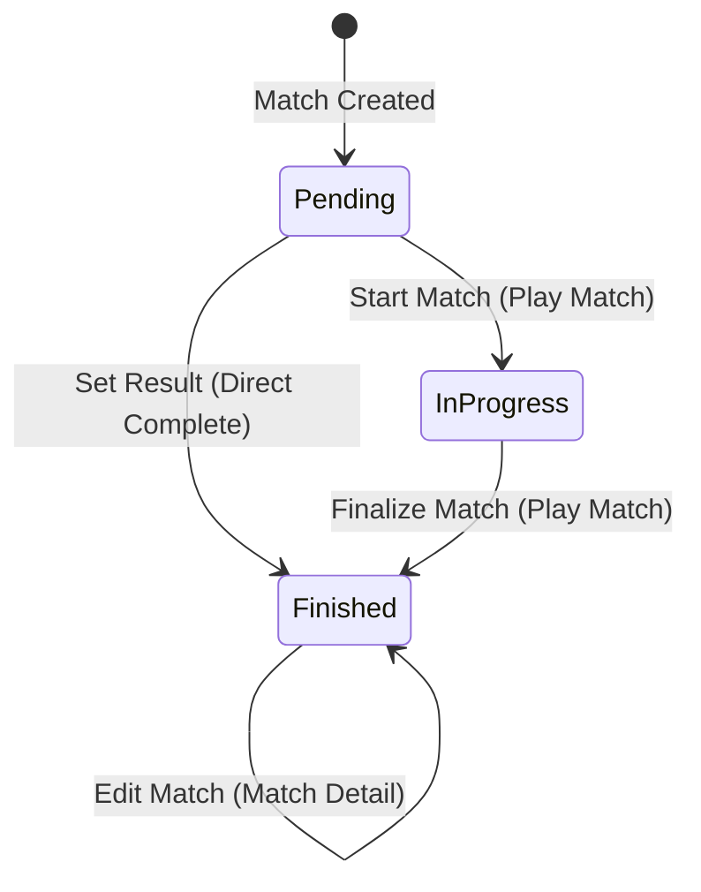

# Data Model: Direct Match Result & Stats Entry

**Feature**: Direct Match Result & Stats Entry (`017-set-completed-match`)  
**Date**: 2026-10-25  
**Status**: Complete  

---

## 1. Entities & Schema Alignment

This feature operates directly on the existing SQLite relational tables (`games` and `player_stats`) via Drizzle ORM. No schema migration is required; the feature populates previously unfilled fields and triggers an immediate state transition.

### 1.1 Game Entity (`games` table)

Represents the scheduled basketball match.

| Field Name | SQLite Column | Type | Default | Direct Result Role |
| :--- | :--- | :--- | :--- | :--- |
| `id` | `id` | `INTEGER PRIMARY KEY` | Auto-inc | Unique game identifier. |
| `teamId` | `team_id` | `INTEGER NOT NULL` | None | References `teams(id)` (Foreign Key). |
| `opponent` | `opponent` | `TEXT NOT NULL` | `""` | Rival team name. |
| `round` | `round` | `TEXT NOT NULL` | `"1"` | Competition round or Jornada. |
| `date` | `date` | `TEXT NOT NULL` | `""` | Match date string (e.g. `"25/10/2026"`). |
| `status` | `status` | `TEXT NOT NULL` | `'pending'` | **Transitions from `'pending'` directly to `'finished'`**. |
| `resultC1` | `result_c1` | `INTEGER` | `0` | Team score in Period 1. |
| `resultC2` | `result_c2` | `INTEGER` | `0` | Team score in Period 2. |
| `resultC3` | `result_c3` | `INTEGER` | `0` | Team score in Period 3. |
| `resultC4` | `result_c4` | `INTEGER` | `0` | Team score in Period 4. |
| `resultExtra` | `result_extra` | `INTEGER` | `0` | Team score in Overtime (optional). |
| `resultC1Opponent` | `result_c1_opponent` | `INTEGER` | `0` | Opponent score in Period 1. |
| `resultC2Opponent` | `result_c2_opponent` | `INTEGER` | `0` | Opponent score in Period 2. |
| `resultC3Opponent` | `result_c3_opponent` | `INTEGER` | `0` | Opponent score in Period 3. |
| `resultC4Opponent` | `result_c4_opponent` | `INTEGER` | `0` | Opponent score in Period 4. |
| `resultExtraOpponent` | `result_extra_opponent` | `INTEGER` | `0` | Opponent score in Overtime (optional). |
| `foulsC1` | `fouls_c1` | `INTEGER` | `0` | Team fouls committed in Period 1. |
| `foulsC2` | `fouls_c2` | `INTEGER` | `0` | Team fouls committed in Period 2. |
| `foulsC3` | `fouls_c3` | `INTEGER` | `0` | Team fouls committed in Period 3. |
| `foulsC4` | `fouls_c4` | `INTEGER` | `0` | Team fouls committed in Period 4. |
| `foulsExtra` | `fouls_extra` | `INTEGER` | `0` | Team fouls committed in Overtime. |
| `foulsC1Opponent` | `fouls_c1_opponent` | `INTEGER` | `0` | Opponent fouls in Period 1. |
| `foulsC2Opponent` | `fouls_c2_opponent` | `INTEGER` | `0` | Opponent fouls in Period 2. |
| `foulsC3Opponent` | `fouls_c3_opponent` | `INTEGER` | `0` | Opponent fouls in Period 3. |
| `foulsC4Opponent` | `fouls_c4_opponent` | `INTEGER` | `0` | Opponent fouls in Period 4. |
| `foulsExtraOpponent` | `fouls_extra_opponent` | `INTEGER` | `0` | Opponent fouls in Overtime. |

---

### 1.2 Player Match Statistic Entity (`player_stats` table)

Represents individual player box score metrics for a given game.

| Field Name | SQLite Column | Type | Default | Calculation / Rule |
| :--- | :--- | :--- | :--- | :--- |
| `id` | `id` | `INTEGER PRIMARY KEY` | Auto-inc | Record identifier. |
| `gameId` | `game_id` | `INTEGER NOT NULL` | None | FK to `games(id)` (`ON DELETE CASCADE`). |
| `playerId` | `player_id` | `INTEGER NOT NULL` | None | FK to `players(id)` (`ON DELETE CASCADE`). |
| `minutes` | `minutes` | `INTEGER` | `0` | Total minutes played (>= 0). |
| `t1a` | `t1a` | `INTEGER` | `0` | Free throws made (1pt). |
| `t1i` | `t1i` | `INTEGER` | `0` | Free throws attempted (`t1i >= t1a`). |
| `t2a` | `t2a` | `INTEGER` | `0` | 2-point field goals made. |
| `t2i` | `t2i` | `INTEGER` | `0` | 2-point field goals attempted (`t2i >= t2a`). |
| `t3a` | `t3a` | `INTEGER` | `0` | 3-point field goals made. |
| `t3i` | `t3i` | `INTEGER` | `0` | 3-point field goals attempted (`t3i >= t3a`). |
| `oreb` | `oreb` | `INTEGER` | `0` | Offensive rebounds. |
| `dreb` | `dreb` | `INTEGER` | `0` | Defensive rebounds. |
| `asis` | `asis` | `INTEGER` | `0` | Assists. |
| `rec` | `rec` | `INTEGER` | `0` | Steals (Recuperaciones). |
| `per` | `per` | `INTEGER` | `0` | Turnovers (Pérdidas). |
| `falt` | `falt` | `INTEGER` | `0` | Personal fouls committed (typically 0-5). |
| `valuation` | `valuation` | `INTEGER` | `0` | Calculated FIBA PIR valuation formula. |

---

## 2. In-Memory Edit Buffer Structures

```typescript
export type PeriodKey = "q1" | "q2" | "q3" | "q4" | "extra";

export interface PeriodScoreInput {
  teamPoints: number;
  teamFouls: number;
  rivalPoints: number;
  rivalFouls: number;
}

export interface PlayerStatInput {
  playerId: number;
  statId?: number;
  minutes: number;
  t1a: number;
  t1i: number;
  t2a: number;
  t2i: number;
  t3a: number;
  t3i: number;
  oreb: number;
  dreb: number;
  asis: number;
  rec: number;
  per: number;
  falt: number;
}

export interface DirectResultBuffer {
  periods: Record<PeriodKey, PeriodScoreInput>;
  players: Record<number, PlayerStatInput>;
  hasExtraTime: boolean;
}
```

---

## 3. Validation Rules

1. **Non-Negativity**: All score, foul, and stat inputs must be integers `>= 0`. Empty input strings default to `0`.
2. **Shot Attempt Consistency**:
   - `t1i >= t1a` (Attempted free throws must be >= made free throws). If user inputs `t1a > t1i`, `t1i` is automatically adjusted or validated.
   - `t2i >= t2a` (Attempted 2-pointers must be >= made 2-pointers).
   - `t3i >= t3a` (Attempted 3-pointers must be >= made 3-pointers).
3. **Cumulative Totals**:
   - `teamTotal = resultC1 + resultC2 + resultC3 + resultC4 + (hasExtra ? resultExtra : 0)`
   - `rivalTotal = resultC1Opponent + resultC2Opponent + resultC3Opponent + (hasExtra ? resultExtraOpponent : 0)`
4. **Valuation Formula**:
   $$\text{Valuation} = (\text{t1a} + \text{t2a} + \text{t3a} + \text{oreb} + \text{dreb} + \text{asis} + \text{rec}) - (\text{per} + \text{falt} + (\text{t1i} - \text{t1a}) + (\text{t2i} - \text{t2a}) + (\text{t3i} - \text{t3a}))$$

---

## 4. State Transitions



- **Trigger**: User presses "Save" in `DirectResultModal`.
- **Precondition**: `game.status === 'pending' || !game.status`.
- **Target State**: `game.status = 'finished'`.
- **Postcondition**:
  - `games` table updated with period scores, period fouls, and `status = 'finished'`.
  - `player_stats` table updated/inserted with all player stat inputs.
  - Action buttons on `GameCards` re-render without the "Set Result" button.
