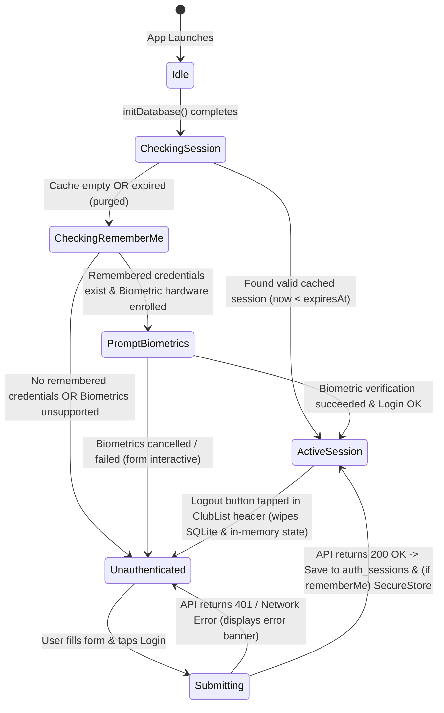

# Data Model: Login View & Session Manager

**Feature**: `018-login-session-manager`  
**Date**: 2026-11-06  
**Status**: Completed  

---

## 1. Domain Entities

### 1.1 User Credentials (Form Input)
Represents the transient, in-memory credential input provided by the user on the Login screen. **Never persisted to SQLite.**

| Field | Type | Required | Description & Validation Rules |
|---|---|---|---|
| `username` | `string` | Yes | Non-empty string. Trimmed of leading/trailing whitespace. Must have length > 0. |
| `password` | `string` | Yes | Non-empty secret string. Masked in UI via `secureTextEntry`. Preserved exactly as typed. Must have length > 0. |
| `rememberMe` | `boolean` | Yes | Toggle flag indicating whether credentials should be saved for fast/biometric login. Default `false`. |

---

### 1.2 User Profile
Represents the authenticated user profile returned from the authentication endpoint.

| Field | Type | Required | Description |
|---|---|---|---|
| `id` | `number` | Yes | Unique identifier for the user account (integer). |
| `username` | `string` | Yes | Handle/username associated with the account. |
| `status` | `string` | Yes | Operational state of the user account (e.g. `"ACTIVE"`). |
| `createdAt` | `string` | Yes | ISO-8601 timestamp string representing when the account was registered. |

---

### 1.3 Authentication Session (`auth_sessions`)
Represents the locally cached authentication session stored in SQLite using Drizzle ORM.

| Field (Column) | SQLite Type | Drizzle Type | Nullable | Default | Description |
|---|---|---|---|---|---|
| `id` | `INTEGER` | `number` | No | Auto-increment PK | Primary key of the local cache entry. |
| `token` | `TEXT` | `string` | No | None | JWT or bearer authorization token string. |
| `token_type` | `TEXT` | `string` | No | `'Bearer'` | Scheme type (e.g., `'Bearer'`). |
| `expires_in` | `INTEGER` | `number` | No | None | Validity lifespan in seconds (from API response, e.g., 86400). |
| `expires_at` | `TEXT` | `string` | No | None | ISO-8601 string representing absolute expiration timestamp (`now + expiresIn * 1000`). |
| `user_id` | `INTEGER` | `number` | No | None | Unique user ID. |
| `username` | `TEXT` | `string` | No | None | Account username. |
| `user_status` | `TEXT` | `string` | No | None | Account status (`ACTIVE`). |
| `user_created_at` | `TEXT` | `string` | No | None | Registration ISO timestamp. |
| `created_at` | `TEXT` | `string` | No | `datetime('now')` | Local session creation timestamp. |

---

### 1.4 Remembered Credentials (Encrypted Secure Storage)
Represents encrypted credentials persisted via `expo-secure-store` (iOS Keychain / Android Keystore). **Never written to SQLite or unencrypted storage.**

| Key | Value Type | Description & Security Policy |
|---|---|---|
| `bcm_remember_me_credentials` | JSON string `{ username: string, password: string, savedAt: string }` | Encrypted payload storing user credentials for fast/biometric authentication. |
| `bcm_remember_me_enabled` | `'true'` \| `'false'` | Flag recording if the user opted into credential persistence. |

---

### 1.5 Biometric State
Represents the mobile device's biometric capability and authentication status.

| Field | Type | Description |
|---|---|---|
| `hasHardware` | `boolean` | True if the device possesses biometric sensors (fingerprint, FaceID). |
| `isEnrolled` | `boolean` | True if the user has enrolled biometrics in OS settings. |
| `supportedType` | `string` | Human-readable descriptor: `'FINGERPRINT'`, `'FACIAL_RECOGNITION'`, or `'NONE'`. |

---

### 1.6 Environment Configuration (`src/core/config/env.ts`)
Represents the application's centralized runtime environment configuration.

| Field | Type | Required | Default / Fallback | Description |
|---|---|---|---|---|
| `API_URI` | `string` | Yes | `'http://localhost:3000'` / `'http://10.0.2.2:8080/api/v1'` | Base URL string pointing to the backend authentication and API server. Trailing slashes stripped. |
| `isProduction` | `boolean` | Yes | `false` | Boolean indicator whether the application is running in production mode (`process.env.NODE_ENV === 'production'`). |

---

## 2. Drizzle ORM Schema Definition

```typescript
import { sqliteTable, text, integer } from "drizzle-orm/sqlite-core";

export const authSessions = sqliteTable("auth_sessions", {
  id: integer("id").primaryKey({ autoIncrement: true }),
  token: text("token").notNull(),
  tokenType: text("token_type").notNull().default("Bearer"),
  expiresIn: integer("expires_in").notNull(),
  expiresAt: text("expires_at").notNull(),
  userId: integer("user_id").notNull(),
  username: text("username").notNull(),
  userStatus: text("user_status").notNull(),
  userCreatedAt: text("user_created_at").notNull(),
  createdAt: text("created_at")
    .notNull()
    .$defaultFn(() => new Date().toISOString()),
});

export type AuthSessionRecord = typeof authSessions.$inferSelect;
export type NewAuthSessionRecord = typeof authSessions.$inferInsert;
```

---

## 3. SQLite DDL Migration Specification

Added to `src/db/index.ts` within `initDatabase()`:

```sql
CREATE TABLE IF NOT EXISTS auth_sessions (
  id INTEGER PRIMARY KEY AUTOINCREMENT,
  token TEXT NOT NULL,
  token_type TEXT NOT NULL DEFAULT 'Bearer',
  expires_in INTEGER NOT NULL,
  expires_at TEXT NOT NULL,
  user_id INTEGER NOT NULL,
  username TEXT NOT NULL,
  user_status TEXT NOT NULL,
  user_created_at TEXT NOT NULL,
  created_at TEXT NOT NULL DEFAULT (datetime('now'))
);
```

---

## 4. Entity Lifecycle & State Transitions



### Transition Invariants
1. **Cache Overwrite**: When `saveSession` is executed, any existing rows in `auth_sessions` are deleted first to maintain exactly zero or one active session.
2. **Expired Cache Purge**: If an expired session is detected during `checkSession()`, `clearSession()` is called immediately to purge the stale row from SQLite.
3. **Remember Me Clean-up**: If a user logs in with `rememberMe = false`, any existing credentials in `expo-secure-store` are purged immediately (FR-024).
4. **Logout Invariant**: Tapping the logout button wipes the SQLite `auth_sessions` cache, clears all in-memory user and token states, and resets navigation state to `LoginView` (< 500ms). Back-navigation to protected views is prevented because root `App.tsx` conditionally unmounts `ClubManage`.
5. **Biometric Resilience**: Biometric failures or cancellations leave the login form interactive with manual inputs and never trigger crash states or user lockouts.
